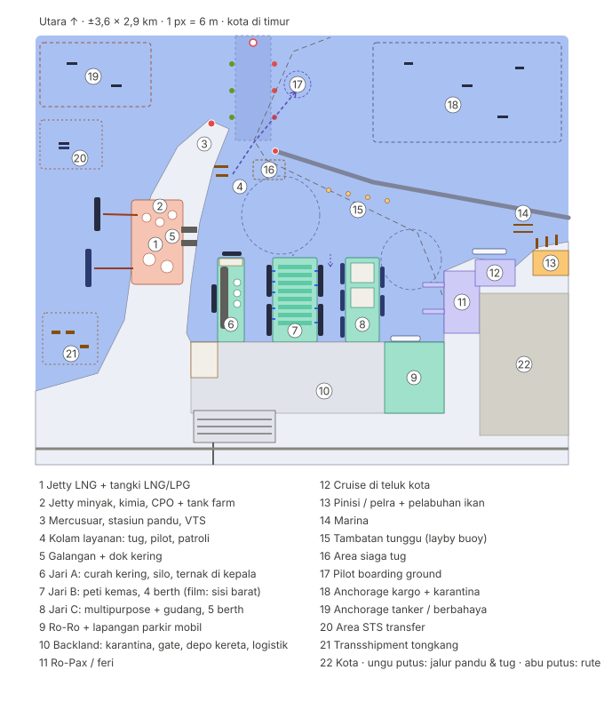
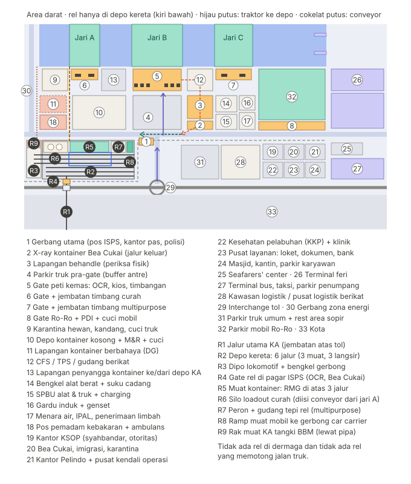

# Menata satu pelabuhan lengkap untuk Portline

**Pembaruan (denah v3).** Bagian "Usulan denah" sekarang memakai denah v3:
- teluk dengan **tanjung alami** di barat (zona energi di sisi luar, galangan dan kolam layanan di sisi dalam);
- **tiga dermaga jari** untuk kargo (sekitar 11 berth);
- teluk kota di timur untuk cruise, pinisi, perikanan, dan marina;
- area laut lengkap: jalur pandu dan tug, area siaga tug, tambatan tunggu, anchorage terpisah, STS, transshipment tongkang;
- fasilitas darat lengkap dengan gate dan jembatan timbang;
- **satu depo kereta terpusat** tanpa rel di dermaga.

Ada juga bagian baru tentang kapal dan terminal yang terlewat, termasuk kapal ternak. Usulan Pulau Energi dan peta 3,4 × 2,6 km di ringkasan di bawah adalah versi awal yang sudah digantikan.

**Ringkasan eksekutif.** Pelabuhan baru Portline paling masuk akal dibangun dengan pola yang dipakai semua pelabuhan multi-terminal yang diteliti. Energi berbahaya ditaruh di tepi laut, dekat pintu masuk, di semenanjung atau jetty sendiri. Peti kemas mendapat air terdalam dan lahan belakang persegi paling luas. Curah kering diberi kluster tersendiri di sisi hilir angin. Penumpang ditaruh paling dalam, menempel ke kota. Gate LNG Rotterdam berada "near the port entrance" ([Port of Rotterdam](https://www.portofrotterdam.com/en/lng-terminal)). Petrokimia Singapura dipisah di Jurong Island ([Wikipedia](https://en.wikipedia.org/wiki/Jurong_Island)). Koper memadatkan **12 terminal dalam ±280 ha** dengan terminal penumpang di dermaga kota tua ([Wikipedia](https://en.wikipedia.org/wiki/Port_of_Koper)), dan itu template terbaik untuk satu peta simulator. Usulan denah di laporan ini memakai peta **3,4 × 2,6 km**. Laut ada di utara, kota di timur, dan satu pintu masuk 300 m di barat laut. Kapal LNG dan tanker berlabuh di **Pulau Energi** di luar breakwater, lewat cabang alur sendiri, jadi tidak pernah melintasi terminal lain. Di dalam kolam utama, dari pintu masuk ke arah kota, urutannya curah kering, peti kemas (satu berth, 3 STS crane, sesuai cerita film), multipurpose, Ro-Ro, Ro-Pax, lalu cruise. Semua ukuran air bisa dihitung dari kapal: alur satu arah ±4B, kolam putar 2 × LOA dengan tug, jarak antar breasting dolphin 0,25–0,4 × LOA. Sebaliknya, hampir semua **jarak aman antar-zona tidak punya angka baku yang terbuka**. SIGTTO, ISGOTT, NFPA 59A, dan PIANC mewajibkan analisis risiko, dan teks lengkapnya berbayar. Karena itu angka pemisahan di laporan ini adalah default model yang sudah dikompresi, bukan standar. Kompresi skala yang disarankan: kapal, crane, kendaraan, dan bangunan tetap ukuran asli (1:1). Geometri air dikompresi ringan (0,8–1,0). Kedalaman lahan belakang dipendekkan menjadi 0,4–0,6 kali aslinya. Jarak bahaya dipendekkan ke ratusan meter, dengan air dan breakwater sebagai penyangga visual. Prioritas pembangunan pertama adalah "kit" laut (breakwater, buoy, dolphin, catwalk, trestle). Kit itu dipakai ulang oleh lima terminal sekaligus, dan semua kapalnya sudah ada di kode tetapi belum punya tempat sandar.

## Pelabuhan nyata memakai satu logika ruang yang sama

Lima kasus yang diteliti menunjukkan urutan yang konsisten, walaupun skalanya sangat berbeda. **Tanjung Priok** punya luas 1.028 ha, 76 berth, dan 16.853 m dermaga ([Wikipedia](https://en.wikipedia.org/wiki/Port_of_Tanjung_Priok)). Priok tumbuh ke timur. Terminal penumpang dan antarpulau tetap di barat dekat kota lama, sedangkan terminal peti kemas terbaru (NPCT1 Kalibaru) dibangun di lahan reklamasi lepas pantai. NPCT1 punya **450 m dermaga, 32 ha, draft 16 m** ([Mitsui](https://www.mitsui.com/jp/en/innovation/business/npct1/index.html?ad=id)), dengan alur dan kolam putar −16,5 m LWS ([ITB](https://journals.itb.ac.id/index.php/jts/article/view/18831/6181)). Terminal mobil Priok direncanakan bersebelahan dengan terminal peti kemas Koja di ujung timur ([JICA](https://openjicareport.jica.go.jp/pdf/11744265_02.pdf)). Di **Rotterdam**, pelabuhan "bermigrasi ke laut". Maasvlakte 2 menambah ±1.000 ha lahan bersih di air dalam ([Port of Rotterdam](https://portofrotterdam.com/en/new-port-area-at-sea)), dan pelabuhan lama di kota beralih fungsi menjadi area budaya ([Wikipedia](https://en.wikipedia.org/wiki/Port_of_Rotterdam)). **Singapura** memindahkan seluruh peti kemas ke Tuas (±1.337 ha) dan membebaskan ±1.000 ha tepi air kota ([MPA](https://mpa.gov.sg/maritime-singapore/port-of-the-future); [CLC](https://knowledgehub.clc.gov.sg/liveability-in-action/box-story--port-and-the-city-balancing-growth-and-liveability/)). Terminal cruise Singapura tetap di kota.

Bagi Portline, pelajarannya ada dua. Pertama, **urutan dari laut ke darat adalah urutan bahaya dan ukuran kapal, bukan urutan abjad**. Terminal yang kapalnya besar dan muatannya berbahaya diletakkan paling dekat ke laut lepas. Terminal yang penggunanya manusia diletakkan paling dekat ke kota. Kedua, **pelabuhan ringkas seperti Koper membuktikan bahwa semua jenis terminal muat di peta kecil**. Syaratnya, setiap terminal diberi kolam atau sisi dermaga sendiri, dengan satu jalan dan rel tulang punggung di belakangnya. Banyak deskripsi tata letak per kolam di catatan riset berasal dari pengamatan peta dan tidak terverifikasi sumber, misalnya kolam mana di Priok untuk apa. Karena itu laporan ini memakai prinsipnya saja, bukan detailnya.

Konvensi tabel di bawah ini sebagai berikut. Kolom **Status** berisi "Sudah ada" (sudah ada di kode simulator) atau "Perlu dibuat". Kolom **Jenis angka** berisi "Bersumber" (ada sitasi), "Turunan" (dihitung dari angka bersumber), "Default model" (aturan praktis untuk pemodelan), atau "Estimasi" (tebakan wajar yang belum diverifikasi).

## Terminal peti kemas: satu dermaga lurus, tiga lajur fungsi

### Bentuk dermaga, kedalaman, dan panjang

Terminal peti kemas modern selalu memakai **dinding dermaga lurus menerus** (*marginal quay*, bukan pier jari). Di belakang tepi dermaga ada tiga strip yang sejajar dengan dermaga. Strip pertama adalah apron, yaitu area di bawah STS crane tempat traktor atau straddle mengambil boks. Strip kedua adalah stack (tumpukan) yang dilayani RTG. Strip ketiga adalah zona serah-terima truk dan gate ([PEMP Ch. 6.5](https://porteconomicsmanagement.org/pemp/contents/part6/container-terminal-design-equipment/)). Panjang berth kira-kira LOA ditambah margin. Contohnya, kapal 8.000 TEU butuh ±325 m dermaga dan draft ±13 m, kapal 12.500 TEU butuh 370 m dan 15,2 m, dan ULCV 400 m butuh ±450 m ([PEMP](https://porteconomicsmanagement.org/pemp/contents/part6/container-terminal-design-equipment/)). Kapal peti kemas Portline sepanjang 214 m termasuk kelas feeder besar sampai Panamax. Panjang berth **±250–300 m** sudah cukup untuk kapal itu ditambah ruang parkir crane (Default model, LOA + 15–40%). Kedalaman yang disarankan **−13 sampai −14 m** (Default model, dengan aturan 1,10–1,15 × draft; angka ini dari catatan riset dan belum dicek ke teks PIANC). Lebar apron tidak ditemukan sumbernya. Default model **50–70 m** dari tepi dermaga ke stack dianggap wajar, karena apron harus menampung rel STS selebar ±30 m ditambah lajur traktor.

### Kapal yang dilayani

| Kapal | Dimensi | Status |
|---|---|---|
| Kapal peti kemas Portline | 214 m | Sudah ada |
| Feeder | ±140 m, ±23 m lebar, ±1.000 TEU ([HPA/CML](https://www.iaphworldports.org/n-iaph/wp-content/uploads/2020/11/Multi-PurposeTerminals_Final_May-2017.pdf)) | Perlu dibuat (opsional) |
| Post-Panamax 8.000 TEU | ±300–325 m, draft ±13 m ([PEMP](https://porteconomicsmanagement.org/pemp/contents/part6/container-terminal-design-equipment/)) | Perlu dibuat (opsional) |
| ULCV | 399,99 m × 61,3 m, 24.346 TEU ([gCaptain](https://gcaptain.com/chinese-shipyard-delivers-worlds-largest-containership-at-24346-teus)) | Tidak disarankan untuk peta ringkas |

### Alat dan kendaraan

| Item | Dimensi tipikal | Jenis angka | Status |
|---|---|---|---|
| STS quay crane (*ship-to-shore*, crane dermaga) | Rail gauge 30,48 m (klasik) / 30,0 m; outreach Panamax ≤38 m, Post-Panamax ≤45 m, Super PP ≤55 m, Megamax 60–75 m; lift height 30–59 m; backreach 0–25 m; lebar buffer-to-buffer 27–36 m; ruang bebas di bawah sill beam 12–18 m ([Liebherr](https://www-assets.liebherr.com/media/bu-media/lhbu-mcc/downloads-und-brosch%C3%BCren-neu/brosch%C3%BCren/container-cranes-(lcc)/mcc_ship_to_shore_cranes_sts/liebherr-port-equipment-sts-datasheet-2026-v2.pdf); [Konecranes](https://www.konecranes.com/system/files/2024-04/7593_sts_monobox_technical_doc_v2.pdf)) | Bersumber (Liebherr didekode dari font yang dipetakan ulang) | Sudah ada |
| RTG (*rubber-tyred gantry*, gantry ban karet di yard) | Span 20,8 m (5 baris + lajur truk), 23,6 m (6+1), 26,4 m (7+1); lift 15,24 m (1-over-4) / 18,1 m (1-over-5); berat 65–82 t ([Konecranes RTG](https://konecranes.com/sites/default/files/2024-11/7681_rtg_technical_document_v7.pdf)) | Bersumber | Sudah ada |
| Straddle carrier | 3-high: tinggi angkat 9,1 m, tinggi total 12,5 m, lebar 4,87 m, ruang dalam 3,47 m ([Konecranes SC](https://konecranes.com/system/files/2024-06/7583_konecranes_noell_straddle_carrier_technical_document_new_brand_v6.pdf)) | Bersumber | Sudah ada |
| Reach stacker | 12,5–13,5 × 4,15–4,25 × ±4,7 m (mast turun), 82–92 t ([Exapro](https://www.exapro.com/kalmar-drg450-75c5xs-p260323365/)) | Bersumber (listing bekas) | Sudah ada |
| Empty handler | Menumpuk kontainer kosong hingga 7–8 tingkat ([PEMP](https://porteconomicsmanagement.org/pemp/contents/part6/container-terminal-design-equipment/)) | Bersumber | Sudah ada |
| Terminal tractor + chassis | Traktor ±5,1 × 2,54 m, wheelbase ±2,95 m ([Kalmar Ottawa](https://www.kalmarottawa.com/terminal-tractors/ottawa-t2-4x2-offroad/); [RWC](https://www.rwcgroup.com/inventory/v1/Current/Kalmar-Ottawa/T2-EV-Electric-Terminal-Tractor/CT150-60--Phoenix-Arizona---24423631)) | Bersumber | Sudah ada |
| Prime mover + skeletal trailer (2 gaya kabin) | Tidak diteliti | — | Sudah ada |
| Forklift 3–5 t | — | — | Sudah ada |
| Kontainer (referensi) | Lebar 2.438 mm, tinggi HC 2.896 mm ([Konecranes RTG](https://konecranes.com/sites/default/files/2024-11/7681_rtg_technical_document_v7.pdf)) | Bersumber | Sudah ada (diasumsikan) |
| Rail-mounted gantry untuk rel (intermodal) | Span 6–10 jalur / 8–12 kontainer ([PEMP](https://porteconomicsmanagement.org/pemp/contents/part6/container-terminal-design-equipment/)) | Bersumber (kasar) | Perlu dibuat (opsional) |
| ASC (*automated stacking crane*) | Blok 9–10 lebar, 1-over-5/6, tegak lurus dermaga ([Kuenz](https://www.porttechnology.org/wp-content/uploads/2020/08/Kuenz_at_APMT_Maasvlakte_II.pdf)) | Bersumber | Perlu dibuat (opsional, bukan untuk film) |
| AGV | ±15 × 3 m, 1 FEU / 2 TEU | Estimasi | Perlu dibuat (opsional) |

Untuk film, 3 STS pada kapal 214 m sudah tepat. Lebar buffer-to-buffer ±27 m menentukan jarak minimum antar-crane, sehingga 3 crane menempati ±90 m dari 214 m panjang kapal. Default model untuk kelas kapal ini adalah outreach 38–45 m (13–16 baris) dan lift height 30–35 m.

### Bangunan dan properti

| Item | Dimensi tipikal | Jenis angka | Status |
|---|---|---|---|
| Dermaga dengan bollard/fender | Panjang 250–300 m, cope edge vertikal | Default model | Sudah ada |
| Gate (kanopi, kios, palang, portal OCR, weighbridge) | Contoh RFP: 4 lajur masuk, 2 keluar, 2 reversibel, antrean tidak tumpah ke jalan umum ([Seaboard Marine](https://www.seaboardmarine.com/notices/request-for-proposals-truck-gate-complex/)) | Bersumber | Sudah ada |
| Reefer rack | Area reefer ±5% dari area stack ([PEMP](https://porteconomicsmanagement.org/pemp/contents/part6/container-terminal-design-equipment/)) | Bersumber | Sudah ada |
| Kantor, light mast, gudang CFS, pagar | — | — | Sudah ada |
| Blok RTG (marka) | 6 baris × 5 tinggi dalam span 23,5 m, panjang blok ±200–260 m, sejajar dermaga | Default model | Perlu dibuat (marka/penataan) |
| Depo kosong + area cuci/reparasi | Tumpukan 7–8 tinggi | Bersumber (tinggi) | Perlu dibuat |
| Parkir pra-gate / buffer truk | — | Estimasi | Perlu dibuat |
| Portal monitor radiasi, gedung X-ray kontainer (Bea Cukai) | Contoh di NC Ports: OCR + RFID + WIM + RPM ([NC Ports](https://ncports.com/port-improvements/container-gate-complex/)) | Bersumber (keberadaan) | Perlu dibuat |
| Bengkel M&R (high-bay) | Kapasitas ±10% armada alat sekaligus ([Wikipedia](https://en.wikipedia.org/wiki/Container_port_design_process)) | Bersumber (rasio) | Perlu dibuat |
| Menara kontrol / pusat operasi, kantin, pos keamanan, gardu listrik, SPBU/charging traktor | — | Estimasi | Perlu dibuat |
| Rel on-dock (2–4 jalur) | — | Estimasi | Perlu dibuat |

### Prinsip tata letak

Urutan strip dari laut ke darat adalah tepi dermaga, rel STS dan apron, blok RTG sejajar dermaga, zona serah-terima truk, lalu gate dan parkir pra-gate. Depo kosong, reefer, CFS, bengkel, dan kantor ditaruh di tepi-tepi zona ([PEMP](https://porteconomicsmanagement.org/pemp/contents/part6/container-terminal-design-equipment/)). Aturan lalu lintas yang paling penting untuk animasi: **truk eksternal tidak pernah masuk apron**. Truk eksternal masuk lewat gate dan dialirkan ke lajur truk di dalam blok RTG. Traktor internal hanya bolak-balik antara apron dan blok. Di simulator, aturan ini paling mudah dibuat dengan loop satu arah dan marka lajur berwarna. Catatan riset tidak menemukan sumber untuk kedalaman terminal (jarak dermaga ke gate). Angka yang sering dikutip, 500–600 m, belum terkonfirmasi.

## Terminal multipurpose dan break bulk: dermaga seragam, gudang transit, MHC

### Bentuk dermaga, kedalaman, dan panjang

Studi Fraunhofer CML untuk HPA merekomendasikan **dinding dermaga menerus yang seragam dan perkerasan heavy-duty yang sama di seluruh terminal**, bukan jalur RTG khusus. Tujuannya agar fungsi bisa berganti antara peti kemas, baja, kayu, dan project cargo ([HPA/CML 2017](https://www.iaphworldports.org/n-iaph/wp-content/uploads/2020/11/Multi-PurposeTerminals_Final_May-2017.pdf)). Terminal pembanding punya draft maksimum 9,5–11,5 m dan LOA maksimum 190–250 m. C. Steinweg Hamburg misalnya: 1.200 m dermaga, 6 berth, draft 11,5 m ([HPA/CML](https://www.iaphworldports.org/n-iaph/wp-content/uploads/2020/11/Multi-PurposeTerminals_Final_May-2017.pdf)). Untuk kapal general cargo Portline sepanjang 140 m, berth yang disarankan **±180–200 m pada −10 sampai −11 m** (Default model). Rasio lahan per meter dermaga di MPT adalah **±180–670 m² per meter**, dan bangunan hanya 2–3% dari luas ([HPA/CML](https://www.iaphworldports.org/n-iaph/wp-content/uploads/2020/11/Multi-PurposeTerminals_Final_May-2017.pdf)). Artinya MPT sebagian besar adalah lapangan terbuka.

### Kapal yang dilayani

Kapal yang dilayani adalah kapal general cargo 140 m dengan deck crane (Sudah ada), kapal heavy-lift/project, feeder, dan kapal Ro-Ro kecil bila ada ramp. Karena kapal Portline membawa crane sendiri, MHC tidak wajib untuk adegan awal.

### Alat dan kendaraan

| Item | Dimensi tipikal | Jenis angka | Status |
|---|---|---|---|
| Mobile harbour crane (MHC, crane pelabuhan beroda) Liebherr LHM 550 | Kapasitas 154 t, outreach 54 m, berat 439 t; tapak outrigger ±13,5 × 13,5 m, puncak menara ±40,7 m ([Liebherr](https://liebherr.com/en/aus/products/maritime-cranes/port-equipment/mobile-harbour-crane/details/lhm550.html); [manuals.plus](https://manuals.plus/m/cae234d6bd1c6e8474d973b22b474d6c6cf27cb9cba1df9119a0bf734b87c422)) | Bersumber | Perlu dibuat |
| SPMT (*self-propelled modular transporter*, transporter modular berpenggerak) | Modul 4 axle-line 5,6–6,0 × 2,43–3,0 m, tinggi 1,2–1,5 m; 6 axle-line 8,4–9,0 m ([TII Scheuerle](https://www.tii-group.com/tii-scheuerle/our-solutions/spmt/scheuerle-spmt); [Mammoet](https://usedequipment.mammoet.com/usedequipment/transport/spmts/3x-scheuerle-pekz-140.8.4-m78-x20-tt20)) | Bersumber | Perlu dibuat |
| Roll trailer (Mafi) | 30 t: 7,28 × 2,5 × 0,75 m; 120 t: dek ±12,2 × 2,59 m pada tinggi 0,73 m ([Machineseeker](https://www.machineseeker.ie/mafi-6300%2F2500%2Fh750+mm/i-22028363); [Exapro](https://www.exapro.com/seacom-ut40-120t-p260731142/)) | Bersumber (listing dealer) | Perlu dibuat |
| Forklift berat 10–45 t | Steinweg memakai forklift hingga 45 t ([HPA/CML](https://www.iaphworldports.org/n-iaph/wp-content/uploads/2020/11/Multi-PurposeTerminals_Final_May-2017.pdf)); dimensi tidak diteliti | Bersumber (kapasitas) | Perlu dibuat |
| Forklift 3–5 t | — | — | Sudah ada |
| Reach stacker, terminal tractor | Lihat terminal peti kemas | Bersumber | Sudah ada |
| Low-loader / heavy trailer 25 t+ | Tidak diteliti | — | Perlu dibuat |
| Crane mobil truk/crawler 10–50 t | Chittagong punya 45 unit 10–50 t ([HPA/CML](https://www.iaphworldports.org/n-iaph/wp-content/uploads/2020/11/Multi-PurposeTerminals_Final_May-2017.pdf)) | Bersumber (kapasitas) | Perlu dibuat |

### Bangunan dan properti

| Item | Dimensi tipikal | Jenis angka | Status |
|---|---|---|---|
| Dermaga + bollard/fender | 180–200 m | Default model | Sudah ada (pakai ulang modul dermaga peti kemas) |
| Strip kerja MHC (apron) | 20–30 m | Turunan (dari tapak MHC) | Perlu dibuat (marka) |
| Gudang transit, sejajar dermaga, pintu rol di kedua sisi panjang | 40–60 × 100–200 m, tinggi talang 8–12 m | Estimasi | Perlu dibuat |
| Gudang CFS | — | — | Sudah ada (bisa jadi gudang kedua) |
| Lapangan terbuka: coil/pelat/pipa baja dengan dunnage, kayu/log, laydown project cargo | — | Estimasi | Perlu dibuat |
| Jalur muat rel | 400–750 m di terminal pembanding ([HPA/CML](https://www.iaphworldports.org/n-iaph/wp-content/uploads/2020/11/Multi-PurposeTerminals_Final_May-2017.pdf)) | Bersumber | Perlu dibuat (versi pendek) |
| Gate 3–4 lajur | Steinweg dan Cuxport: 3 lajur ([HPA/CML](https://www.iaphworldports.org/n-iaph/wp-content/uploads/2020/11/Multi-PurposeTerminals_Final_May-2017.pdf)) | Bersumber | Sudah ada (pakai ulang gate) |

### Prinsip tata letak

Gudang transit ditaruh sejajar dermaga di baris pertama. Di belakangnya ada lapangan terbuka per komoditas, lalu rel di sisi gudang, lalu gate. Dalam peta ringkas, MPT cocok ditaruh di antara terminal peti kemas dan Ro-Ro, karena peralatannya (reach stacker, traktor, Mafi) dipakai bersama kedua terminal itu.

## Terminal curah kering: crane grab di dermaga, conveyor ke stockyard

### Bentuk dermaga, kedalaman, dan panjang

Terminal curah kering dibagi dua jenis. **Berth impor** memakai grab unloader di atas rel (400–2.500 t/jam) atau screw unloader kontinu yang menuang ke conveyor dermaga. **Berth ekspor** memakai shiploader berjalan atau radial (hingga ±10.000 t/jam untuk bijih) yang diumpan conveyor panjang dari stockyard ([TAKRAF](https://www.takraf.com/product/ship-unloaders/); [Dry Cargo](https://www.drycargomag.com/lightening-the-load-–-ever-improving-technologies-simplify-the-shiploading-process)). Berth impor umumnya berupa dermaga padat atau dek di atas tiang. Berth ekspor sering berupa trestle dengan galeri conveyor menuju jetty terbuka (Default model). Kapal curah Portline sepanjang 190 m termasuk kelas **Handymax/Supramax**: 150–200 m, lebar 30–32 m, draft 10–12 m ([Clarksons](https://www.clarksons.com/home/glossary/v/a-guide-to-bulk-vessel-sizes/)). Berth yang disarankan **±230–260 m pada −12 sampai −13 m** (Default model).

### Kapal yang dilayani

| Kapal | Dimensi | Status |
|---|---|---|
| Bulk carrier Portline (Handymax/Supramax) | 190 m; kelas ini biasanya punya 5 palka dan 4 crane ([Wikipedia](https://en.wikipedia.org/wiki/Bulk_carrier)) | Sudah ada |
| Panamax bulk | ≤294,13 × 32,31 m, draft 12,04 m ([Wikipedia](https://en.wikipedia.org/wiki/Bulk_carrier)) | Perlu dibuat (opsional) |
| Capesize / Newcastlemax | ≤300 m, lebar ≤50 m ([Wikipedia](https://en.wikipedia.org/wiki/Bulk_carrier)) | Tidak disarankan untuk peta ringkas |

### Alat dan kendaraan

| Item | Dimensi tipikal | Jenis angka | Status |
|---|---|---|---|
| Grab ship unloader (portal di atas rel) | Rail span 11–30 m, outreach 30–50 m ([Konecranes AGD](https://lamong.konecranes.com/sites/default/files/2018-11/agdgrabunloader_0.pdf)); grab 6–40 t, siklus ±50 dtk ([Wikipedia](https://en.wikipedia.org/wiki/Bulk_carrier)) | Bersumber | Perlu dibuat |
| Continuous/screw unloader | Bruks Siwertell 3.000 t/jam untuk kapal ≤230.000 DWT ([Bruks Siwertell](https://bruks-siwertell.com/ship-unloading/stationary-and-rail-mounted-unloaders)) | Bersumber (kapasitas) | Perlu dibuat (opsional) |
| Shiploader berjalan | Rail gauge 21 m, alas sudut 19 m, boom luffing dengan shuttle head ([thyssenkrupp](https://ucpcdn.thyssenkrupp.com/_legacy/UCPthyssenkruppBAIS/assets.files/products___services/mining_systems/materials_handling/shiploaders/shiploader-qinhuangdao_koordinaten.pdf)) | Bersumber | Perlu dibuat (opsional, untuk ekspor) |
| Stacker-reclaimer | Boom 47,5 m, tinggi 28,5 m di atas rel, rail gauge 10 m ([DirectIndustry TAKRAF](https://directindustry.com/prod/takraf/product-58547-1519895.html)) | Bersumber | Perlu dibuat |
| MHC dengan grab | Lihat MPT | Bersumber | Perlu dibuat (pakai ulang MHC) |
| Wheel loader, dump truck, gerbong curah | Tidak diteliti | — | Perlu dibuat |

### Bangunan dan properti

| Item | Dimensi tipikal | Jenis angka | Status |
|---|---|---|---|
| Stockpile (prisma segitiga) | Lebar ±50–56 m, tinggi 14–21 m, panjang ratusan meter; stacker boom 50 m melayani tumpukan 56 m di jalur 820 m ([TAKRAF](https://pdf.directindustry.com/pdf/takraf/stacker-as-g-525050/58547-220815.html); [BSH](https://www.bulk-online.com/sites/default/files/public/2024-01/BSH_1993_03_004.pdf)) | Bersumber | Perlu dibuat |
| Rumus tinggi tumpukan | Tinggi ≈ 0,37 × lebar (sudut curai 35–38°) | Turunan | — |
| Galeri conveyor tertutup di atas trestle | Lebar 3–4 m | Estimasi | Perlu dibuat |
| Menara transfer (di titik belok conveyor) | Tinggi 15–30 m | Estimasi | Perlu dibuat |
| Hopper muat truk, silo muat rel melintasi jalur, wagon tippler + hopper bawah tanah | Tidak diteliti | — | Perlu dibuat |
| Silo gandum/semen (baterai silinder), kubah geodesik (klinker/batubara) | Tidak diteliti | — | Perlu dibuat |
| Pagar angin (*wind fence*) di sekeliling stockyard | — | Estimasi | Perlu dibuat |

### Prinsip tata letak

Urutannya: dermaga dengan conveyor di sepanjang dermaga, conveyor tegak lurus dermaga menuju stockyard, rel stacker-reclaimer di antara dua tumpukan, lalu loop rel dan hopper truk di sisi darat. Curah kering tidak butuh jarak aman bahaya. Yang perlu diatur adalah posisinya terhadap angin, karena **debu harus terbawa menjauhi kota dan reefer stack**. Catatan riset tidak menemukan sumber primer untuk aturan "curah di hilir angin" ini. Aturan itu adalah praktik perencanaan umum. Di Indonesia arah angin monsun berbalik musiman (barat pada Des–Mar, timur pada Jun–Sep), sehingga silo atau kubah tertutup lebih aman daripada mengandalkan arah angin saja.

## Terminal curah cair: jetty di atas trestle, dolphin dihitung dari LOA

### Bentuk dermaga, kedalaman, dan panjang

Berth minyak dan kimia hampir selalu berupa **jetty terbuka**. Sebuah trestle membawa jalan dan pipe rack ke loading platform (kepala jetty). Platform itu memuat loading arm, menara gangway, fire monitor, dan ruang kontrol. **Breasting dolphin** (dolphin penahan sandar) menahan beban sandar di badan paralel kapal. **Mooring dolphin** (dolphin tambat), yang dihubungkan catwalk, menahan tali haluan, buritan, dan tali melintang pada quick release hook. Jaraknya dihitung dari kapal. **Jarak antar breasting dolphin = 0,25–0,4 × LOA**, dan **jarak mooring dolphin ke breasting dolphin = 0,5 × (LOA − jarak BD)** ([E3S Conf. 2024](https://www.e3s-conferences.org/articles/e3sconf/pdf/2024/09/e3sconf_issat2024_03006.pdf)). Untuk tanker Portline 230 m, hasilnya jarak BD 58–92 m. Dengan memilih ±75 m, mooring dolphin berada ±78 m di luar tiap BD, kira-kira ±115 m dari pusat manifold (Turunan). Kedalaman yang disarankan **−13 sampai −15 m**, dan platform berukuran ±30–40 × 20–30 m (keduanya Default model, tidak bersumber). VLCC (±330 m × 55 m) sering dilayani SPM atau sea island lepas pantai ([PEMP](https://porteconomicsmanagement.org/tanker-size/); [Wikipedia](https://en.wikipedia.org/wiki/Oil_tanker)). Draft VLCC antar-sumber saling bertentangan (20 m vs 28 m), jadi jangan dijadikan acuan.

### Kapal yang dilayani

Kapal yang dilayani adalah tanker Portline 230 m (Sudah ada; secara ukuran kira-kira kelas LR2/Aframax, Estimasi), tanker produk MR (Perlu dibuat, opsional), dan bunker barge 60–100 m (Perlu dibuat, Estimasi).

### Alat dan kendaraan

| Item | Dimensi tipikal | Jenis angka | Status |
|---|---|---|---|
| Loading arm (marine loading arm) | 2–4 lengan 8–12 in; VLCC 16 in | Estimasi | Perlu dibuat |
| Menara gangway (menara rangka dengan gangway putar dan luffing) | — | Estimasi | Perlu dibuat |
| Menara fire monitor (2 di platform) | Tinggi 15–25 m | Estimasi | Perlu dibuat |
| Quick release hook + capstan | 2–4 hook per mooring dolphin | Estimasi | Perlu dibuat |
| Truk tangki, mobil pemadam bandara-tipe foam | Tidak diteliti | — | Perlu dibuat |

### Bangunan dan properti

| Item | Dimensi tipikal | Jenis angka | Status |
|---|---|---|---|
| Trestle (dek di atas tiang, jalan + 2–4 tingkat pipe rack) | Ratusan meter | Estimasi | Perlu dibuat |
| Breasting dolphin (cap beton di atas tiang, fender cone/cell besar) | 2 unit, jarak 58–92 m untuk kapal 230 m | Turunan | Perlu dibuat |
| Mooring dolphin + catwalk rangka baja | 4 unit, mundur 10–35 m dari garis sandar | Turunan / Estimasi | Perlu dibuat |
| Tangki floating-roof (crude, bensin) | Ø 60–100 m × 20–22 m (crude); produk Ø 20–50 × 15–20 m | Estimasi | Perlu dibuat |
| Tangki cone-roof (diesel, fuel oil), tangki kimia kecil | — | Estimasi | Perlu dibuat |
| Bund (tanggul) per tangki | Kapasitas 110% isi tangki, dinding tanah berlapis beton tanpa tembusan ([Marsh 2015](https://www.marsh.com/content/dam/marsh/Documents/PDF/UK-en/Risk%20Engineering%20Position%20Paper%2001%20Atmospheric%20Storage%20Tanks%202015.pdf)); tinggi 1–2 m (Estimasi) | Bersumber + Estimasi | Perlu dibuat |
| Rumah pompa, manifold darat, ring foam pourer, tangga spiral, wind girder | — | Estimasi | Perlu dibuat |

### Prinsip tata letak

Jarak antar tangki versi asuradur adalah **≥1 diameter tangki terbesar dan minimum 15 m untuk non-crude, serta 5 diameter untuk crude** karena risiko boilover ([Marsh 2015](https://www.marsh.com/content/dam/marsh/Documents/PDF/UK-en/Risk%20Engineering%20Position%20Paper%2001%20Atmospheric%20Storage%20Tanks%202015.pdf)). NFPA 30 lebih longgar: **1/6 jumlah diameter dua tangki bersebelahan** untuk tangki floating-roof ≤45 m ([NFPA 30 workbook](https://www.slideshare.net/tamersafety/2011-0222nfpa30tankstorageworkbook)). Untuk simulator, aturan 1D cukup murah secara visual, sedangkan 5D untuk crude memakan terlalu banyak lahan. Jalan tengahnya, tangki crude diberi bund sendiri dan jarak ±1,5–2D (Default model). Jetty harus dijauhkan dari alur, karena gaya hidrodinamika pada kapal yang sedang tambat naik ketika kapal lain lewat dekat ([West of England P&I](https://www.westpandi.com/globalassets/loss-prevention/loss-prevention-safety-alerts/west-of-england---loss-prevention-safety-alert----interaction-damage-to-vessels-moored-alongside.pdf)). Salah satu contoh aturan lokal adalah **zona aman 30 m di darat dan air** di sekitar tanker yang sedang bongkar muat ([Kvarken Ports](https://kvarkenports.com/download/18.746961ab192b2b4051a5d97/1729851951668/Safety%20instructions%202024.pdf)).

## Terminal gas LNG/LPG: pola jetty minyak, tangki 86 m, lokasi paling luar

### Bentuk dermaga, kedalaman, dan panjang

Jetty LNG mengikuti pola jetty minyak, dengan perbedaan berikut. Jumlah dolphin lebih banyak: Hazira memakai **4 breasting + 5 mooring dolphin**. Lengannya cryogenic **16 in, 3 unit (2 cair + 1 uap), berjarak 4 m**, dan hook-nya **125 t** ([Shell Hazira, via cuplikan indeks](https://shell.in/shellenergy/hazira-port-pvt-ltd/information-for-ships/lng-jetty-description.html); [Port Technology](https://porttechnology.org/wp-content/uploads/2019/05/PT46-02.pdf)). Gate Rotterdam punya 2 jetty untuk kapal 65.000–267.000 m³ dengan **kedalaman 14 m**, ditambah berth skala kecil untuk kapal 1.000–20.000 m³ ([Gate terminal](https://www.gateterminal.com/en/commercial/facilities-main-characteristics/)). Kapal Moss Portline sepanjang 260 m termasuk kelas ±125–180 ribu m³ (Estimasi). Untuk kapal ini, jarak BD **65–104 m** (Turunan). Dengan BD 90 m, mooring dolphin berada ±85 m di luar tiap BD. Kedalaman yang disarankan **−13 sampai −14 m**.

### Kapal yang dilayani

| Kapal | Dimensi | Status |
|---|---|---|
| LNG carrier Moss Portline | 260 m | Sudah ada |
| LNG carrier 174.000 m³ (membran) | 295 × 46 m, draft 11,4 m ([Marine Insight](https://www.marineinsight.com/biggest-lng-ships/)) | Perlu dibuat (opsional) |
| Q-Max | 345 × 53,8 m, draft ±12 m ([Wikipedia](https://en.wikipedia.org/wiki/Q-Max)) | Tidak disarankan |
| FSRU (kapal penyimpanan + regasifikasi) | ±280–295 m; bisa memakai ulang mesh LNG + modul regas di dek | Perlu dibuat (opsional) |
| Kapal LPG, kapal bunker LNG kecil | Tidak diteliti | Perlu dibuat |

### Alat dan kendaraan

| Item | Dimensi tipikal | Jenis angka | Status |
|---|---|---|---|
| Lengan cryogenic tipe pantograf berpemberat | 16 in, berjarak 4 m; tinggi parkir ±20–25 m | Bersumber (ukuran pipa, jarak) / Estimasi (tinggi) | Perlu dibuat |
| Lengan HPNG untuk FSRU | 12 in, ANSI 600/900 ([TechnipEnergies](https://ten.com/sites/energies/files/2024-09/Loading-systems-brochure.pdf)) | Bersumber | Perlu dibuat (opsional) |
| Menara gangway, 2 menara fire monitor, water curtain | — | Estimasi | Perlu dibuat |

### Bangunan dan properti

| Item | Dimensi tipikal | Jenis angka | Status |
|---|---|---|---|
| Tangki LNG full containment (dalam 9% Ni, luar beton prategang) | Gate: 180.000 m³ bersih, **Ø ±86 m, dinding 40 m, puncak kubah 55 m** ([Gate](https://www.gateterminal.com/en/gate-terminal/profiel/facts-figures/)); sumber lain menyebut tinggi ±46 m | Bersumber (ada konflik tinggi) | Perlu dibuat |
| Open rack vaporiser (unit tirai air laut panjang dan rendah) | Gate memakai 8 unit ([Gate](https://www.gateterminal.com/en/commercial/facilities-main-characteristics/)) | Bersumber (jumlah) | Perlu dibuat |
| Gedung kompresor BOG, kolom recondenser, pompa send-out HP, stasiun metering | — | Estimasi | Perlu dibuat |
| Flare elevated atau ground flare | 80–120 m | Estimasi | Perlu dibuat (opsional) |
| Bola LPG di atas kaki | 3.000 m³ ≈ Ø 18–19 m ([CR4](https://cr4.globalspec.com/thread/97667/LPG-Sphere-Thickness)); cek πD³/6 → 17,9 m | Bersumber + Turunan | Perlu dibuat |
| Bullet LPG horizontal | Hingga Ø ±7 m × 70+ m ([Chemical Engineering](https://www.chemengonline.com/a-primer-on-lpg-storage-systems/)) | Bersumber | Perlu dibuat |
| Rumah ESD/kontrol, palung tumpahan, gerbang keamanan di pangkal trestle | — | Estimasi | Perlu dibuat |

### Prinsip tata letak

Angka jarak aman dari SIGTTO (terbitan 2024 yang menggantikan IP14), NFPA 59A, dan ISGOTT 6 tidak bisa diambil karena teksnya berbayar ([SIGTTO](https://sigtto.org/publications/liquefied-gas-terminals-site-selection-design-and-operation-of-marine-facilities)). Semua sumber itu mensyaratkan analisis risiko. Angka 3,5 km yang beredar berasal dari situs advokasi dan tidak boleh dipakai sebagai standar ([Save Passamaquoddy Bay](https://savepassamaquoddybay.org/standards.html)). Arah kebijakannya tetap jelas. Di Gate Rotterdam, letak di pintu masuk membuat kapal LNG menghabiskan waktu sesingkat mungkin di dalam pelabuhan. Satu jetty LNG bahkan menggeser mooring dolphin-nya 45 m agar pas dengan breakwater ([Port Technology](https://porttechnology.org/wp-content/uploads/2019/05/PT46-02.pdf)). Bagi Portline, LNG adalah terminal paling luar, dengan alur cabang sendiri dan zona larangan bergerak di sekitar kapal LNG yang sedang lewat. Kapasitas tangki bisa dicek dengan rumus π/4 × D² × H: diameter 86 m dengan tinggi cairan ±31 m menghasilkan ±180.000 m³ (Turunan). Dua tangki berjarak 1D sudah cukup meyakinkan secara visual.

## Terminal Ro-Ro (PCTC): dermaga polos, ramp dari kapal, lapangan parkir luas

### Bentuk dermaga, kedalaman, dan panjang

PCTC membawa ramp sendiri. Stern quarter ramp-nya miring **30–45° dari sumbu kapal** ([Wärtsilä](https://www.wartsila.com/encyclopedia/term/ramps)), dengan lebar jalan **9–10 m** dan beban izin hingga **300 t** pada desain modern ([Knud Hansen 8600 CEU](https://www.knudehansen.com/wp-content/uploads/2025/11/8600-CEU-DF-PCTC-22014.pdf); [Knud Hansen 12200 CEU](https://www.knudehansen.com/wp-content/uploads/2025/11/12200-CEU-PCTC-22014.27-Vers.-D-with-sleipner-logo.pdf)). Akibatnya dermaga cukup **lurus dan polos tanpa linkspan**, asalkan apron bebas dari crane dan rel. Studi JICA untuk Priok memakai berth mobil **−10 m × 250 m** untuk satu kapal, dan pada rencana lanjutan **460 m pada −12 m** untuk dua berth ([JICA](https://openjicareport.jica.go.jp/pdf/11744265_02.pdf); [JICA](https://openjicareport.jica.go.jp/pdf/12068599_05.pdf)). Untuk PCTC Portline 200 m, berth yang disarankan **240–250 m pada −10 sampai −11 m**. Panjang ramp ±30–40 m tidak bersumber (Estimasi), jadi sediakan **bantalan pendaratan ramp** bercat ±40 × 20 m di samping buritan.

### Alat dan kendaraan

| Item | Dimensi tipikal | Jenis angka | Status |
|---|---|---|---|
| PCTC dengan stern quarter ramp | 200 m | — | Sudah ada |
| Terminal tractor (Ro-Ro tug) + Mafi | Mafi 30 t: 7,28 × 2,5 × 0,75 m; 120 t: ±12,2 × 2,59 m (lihat MPT) | Bersumber | Sudah ada (traktor) / Perlu dibuat (Mafi) |
| Mobil penumpang (muatan) | Petak parkir bersih ±12,5 m² ([HK TD](https://www.td.gov.hk/filemanager/en/content_5055/V7_11_2025.pdf)) | Bersumber | Perlu dibuat |
| Truk car-transporter, gerbong pengangkut mobil (opsional) | Tidak diteliti | — | Perlu dibuat |
| Minibus antar-jemput sopir | Tidak diteliti | — | Perlu dibuat |
| Alat berat high & heavy (traktor pertanian, ekskavator) sebagai muatan | Tidak diteliti | — | Perlu dibuat |

### Bangunan dan properti

| Item | Dimensi tipikal | Jenis angka | Status |
|---|---|---|---|
| Dermaga lurus + fender/bollard | 240–250 m | Default model | Sudah ada (pakai ulang) |
| Lapangan parkir: blok 5×4, baris diagonal, fishbone untuk pra-sortir ([PEMP](https://porteconomicsmanagement.org/storage-car-terminals/)) | Kotor ±20–25 m² per mobil termasuk lorong | Bersumber (pola) / Estimasi (kepadatan) | Perlu dibuat |
| Gedung parkir bertingkat 4–6 dek dengan ramp | Bremerhaven: 8 gedung, ±70.000 slot di ±295 ha ([BLG](https://blg-logistics.com/en/autoterminal-bremerhaven)) | Bersumber (contoh) | Perlu dibuat |
| Pusat teknis PDI, tempat cuci, gatehouse, area muat truk | — | Estimasi | Perlu dibuat |
| Light mast, kantor | — | — | Sudah ada |

### Prinsip tata letak

Lahan Ro-Ro sebagian besar berupa lapangan datar, dan angka luasnya bervariasi. IPCC Priok berkembang dari 7,38 ha menjadi 16,9 ha, dan sumber promosi menyebut hingga 31 ha ([IPCC 2018](https://www.transportevents.com/presentations/johor2018/IPC_CarTerminal.pdf)). Bremerhaven, bila dihitung termasuk jalan dan rel, memakai ±42 m² per slot. Taruh Ro-Ro bersebelahan dengan peti kemas dan MPT, seperti rencana JICA di Priok, supaya traktor, Mafi, gate, dan rel bisa dipakai bersama.

## Terminal Ro-Pax/feri: slot berth, linkspan, dan lajur antre bernomor

### Bentuk dermaga, kedalaman, dan panjang

Feri Ro-Pax memakai ramp haluan atau buritan, bukan quarter ramp ([PEMP](https://porteconomicsmanagement.org/pemp/contents/part5/automotive-roro-markets/ramps-roro-vessels/)). Akibatnya berth-nya berbentuk **slot atau jari**: dinding fender atau deret dolphin di satu atau kedua sisi menuntun buritan kapal masuk ke **linkspan**, yaitu jembatan ramp yang bisa naik-turun mengikuti pasang surut. Linkspan berukuran **±25–45 m panjang dan 8–28 m lebar (2–3 lajur)**. Tipenya ada yang mengapung (ponton atau submerged-tank), ada yang diangkat hidraulik, kawat, atau counterweight ([Wikipedia: Linkspan](https://en.wikipedia.org/wiki/Linkspan)). Linkspan dua dek di Portsmouth punya dek bawah **32 × 45 m, 700 t, 3 lajur HGV** dan dek atas 500 t dengan 2 lajur ([Maritime Journal](https://www.maritimejournal.com/?p=213177)). Untuk feri 120 m, disarankan slot berth **±130–150 m** (Estimasi) dengan linkspan satu dek **±30 × 18 m** dan kedalaman **−7 sampai −8 m** (Estimasi).

### Alat, kendaraan, bangunan, dan properti

| Item | Dimensi tipikal | Jenis angka | Status |
|---|---|---|---|
| Feri Ro-Pax dengan ramp buritan | 120 m | — | Sudah ada |
| Linkspan (dek berengsel, menara angkat atau ponton, pagar samping, stop fender) | 25–35 × 15–20 m | Bersumber (rentang) / Default model | Perlu dibuat |
| Linkspan dek atas (untuk feri >200 m) | Lihat Portsmouth | Bersumber | Perlu dibuat (opsional) |
| Dinding fender / breasting dolphin dengan catwalk | — | Estimasi | Perlu dibuat (pakai kit dolphin) |
| Lorong penumpang tertutup di atas tiang + kepala gangway | Kiel: terowongan 2 m, panjang maksimum 45 m ([ADELTE](https://www.adelte.com/project/kiel-schwedenkai-terminal)); Dover: walkway 1,75 m ([Dover Ferry Photos](https://www.doverferryphotosforums.co.uk/project-42-number-1-berth-eastern-docks/)) | Bersumber | Perlu dibuat |
| Booth imigrasi, lalu booth check-in operator (gaya gerbang tol, 4–10 unit, berkanopi), lalu lajur antre bernomor ([P&O Ferries](https://blog.poferries.com/2019/03/08/what-to-expect-when-you-check-in-at-dover)) | Lajur ±3,5 m × 100–200 m | Bersumber (urutan) / Estimasi (ukuran) | Perlu dibuat (bisa turunan modul gate) |
| Gudang pemeriksaan sekunder, parkir trailer tanpa pengemudi, area HGV terpisah | — | Estimasi | Perlu dibuat |
| Gedung terminal penumpang (loket, ruang tunggu, kafe) | — | Estimasi | Perlu dibuat |
| Mobil, campervan, bus, HGV, motor; bus penumpang pejalan kaki; traktor trailer | Tidak diteliti | — | Perlu dibuat (traktor sudah ada) |

### Ponton feri kecil dan water taxi

Kapal kecil memakai **ponton terapung** yang dihubungkan ke darat oleh **gangway berengsel**. Kemiringan gangway dijaga **≤1:12** di rentang pasang desain, maksimum 1:8 di luar rentang itu, dengan kemiringan melintang ≤1:48 ([US Access Board](https://www.access-board.gov/advisory-committee-reports/passenger-vessels/pvaac-report-ch02/)). Gangway feri di AS panjangnya ±10,7–40 m ([National Academies](https://nap.nationalacademies.org/read/26748/chapter/12)). Untuk simulator, cukup buat ponton ±25 × 8 m, 2 tiang pemandu dengan cincin, gangway aluminium 15–25 m, platform abutment, halte, mesin tiket, water taxi, dan feri kecil (semuanya Perlu dibuat; ukuran ponton Estimasi). Sudut gangway bisa dianimasikan mengikuti pasang surut.

### Prinsip tata letak

HSE memperlakukan linkspan dan walkway sebagai bahaya tersendiri yang **wajib memisahkan kendaraan dan pejalan kaki** ([HSE](https://www.hse.gov.uk/ports/linkspans-walkways.htm)). Dari darat ke kapal, urutannya adalah jalan masuk, booth imigrasi, booth check-in, lajur antre bernomor, lalu linkspan. Lorong pejalan kaki berjalan di atas semua itu secara terpisah. Ro-Pax ditaruh dekat kota karena penumpang pejalan kaki dan mobil pribadi datang dari kota, tetapi akses HGV-nya tetap lewat jalan pelabuhan.

## Terminal cruise: dermaga panjang, PBB, gedung 8.000–10.000 m²

### Bentuk dermaga, kedalaman, dan panjang

Berth cruise adalah dermaga atau pier lurus yang panjang. Panjangnya **≥ LOA + 10%** dan diameter kolam putarnya **2 × LOA** ditambah cadangan cuaca. Fender dipasang sepanjang muka dermaga, dan dolphin dipakai bila pier lebih pendek dari kapal ([PEMP](https://porteconomicsmanagement.org/cruise-terminal-design-equipment/)). Untuk kapal penumpang Portline 230 m, hasilnya berth **≥253 m** dan kolam putar **±460 m** (Turunan). Kedalaman yang disarankan **−9 sampai −10 m** (Estimasi). Apron dipakai untuk penanganan tali, bagasi, utilitas, sampah, truk perbekalan, dan akses darurat ([PEMP](https://porteconomicsmanagement.org/cruise-terminal-design-equipment/)). Lebarnya ±20–30 m (Estimasi).

### Alat, kendaraan, bangunan, dan properti

| Item | Dimensi tipikal | Jenis angka | Status |
|---|---|---|---|
| Kapal penumpang | 230 m | — | Sudah ada |
| PBB (*passenger boarding bridge*, jembatan penumpang) di atas rel, 1–2 per berth | Pintu kapal 1,1–9,5 m di atas dermaga ([ADELTE ARGOS](https://pdf.nauticexpo.com/pdf/adelte/argos-gangway/61418-81389.html)); 2 gangway otomatis >1.000 pax/jam ([PEMP](https://porteconomicsmanagement.org/cruise-terminal-design-equipment/)); terowongan ±2 m (Estimasi) | Bersumber | Perlu dibuat |
| Gangway/tangga mobile untuk kapal transit | — | — | Perlu dibuat |
| Gedung terminal 2 lantai (turun kapal di lantai dasar, naik kapal di lantai atas) | Tenerife 8.400 m² ([Seatrade](https://www.seatrade-cruise.com/ports-destinations/santa-cruz-de-tenerife-presents-europe-s-newest-cruise-terminal)); Southampton ±9.300 m²; PortMiami MSC ±45.700 m² ([Dezeen](https://www.dezeen.com/2026/09/16/arquitectonica-msc-cruise-terminal-port-miami/amp/)) | Bersumber | Perlu dibuat (disarankan ±90 × 50 m × 2 lantai) |
| Aula bagasi + conveyor, kereta bagasi, baggage tug | — | Estimasi | Perlu dibuat |
| Dok truk perbekalan, area palet di apron | — | Estimasi | Perlu dibuat |
| Kabinet/crane kabel shore power, hidran air bersih, skip sampah | — | Estimasi | Perlu dibuat |
| Teluk bus (gigi gergaji), antrean taksi, loop drop-off, parkir mobil | — | Estimasi | Perlu dibuat |
| Bus, taksi, truk perbekalan, forklift | — | — | Forklift sudah ada; sisanya Perlu dibuat |
| Pagar dan gerbang keamanan | ISPS ≥2 m ([TT Club](https://ttclub.com/news-and-resources/news/article/tt-talk-port-and-terminal-security)) | Bersumber | Sudah ada (pagar) |

### Prinsip tata letak

Gedung terminal sejajar dermaga, PBB berjalan di rel pada walkway layang di sisi laut gedung, dan transportasi darat di sisi kota. Terminal cruise **jarang punya gudang** karena perbekalan datang just-in-time segera setelah kapal sandar ([PEMP](https://porteconomicsmanagement.org/cruise-terminal-design-equipment/)). Akibatnya apron harus lega untuk truk. Di semua kasus pelabuhan yang diteliti, cruise selalu menempel ke pusat kota dan transportasi umum.

## Kapal dan terminal tambahan yang belum tercakup riset awal

Riset awal belum mencakup beberapa jenis kapal dan terminal. Yang paling penting adalah **kapal ternak** (livestock carrier), karena impor sapi dari Australia masuk lewat pelabuhan seperti Tanjung Priok dan Panjang. Daftar di bawah disusun dari pengetahuan umum dan **belum diriset dengan sumber**. Semua dimensinya berjenis angka **Estimasi** dan perlu diverifikasi sebelum dibuat.

**Terminal ternak** (sudah masuk denah v3 di kepala dermaga A dan karantina di backland barat) butuh:
- berth dengan ramp dan jalur sapi yang tertutup ke truk ternak;
- kandang transit;
- **karantina hewan**: kandang isolasi, pemeriksaan dokter hewan;
- tempat cuci truk dan kapal, serta pengolahan limbah (IPAL).

Terminal ini ditempatkan di hilir angin, jauh dari kota dan area penumpang. Kapal ternaknya sendiri perlu dibuat: kapal bergeladak bertingkat terbuka dengan ventilasi, tangki pakan, dan rumah kemudi di depan atau belakang.

| Kelompok | Kapal / terminal | Fasilitas khas | Relevansi Indonesia | Status di denah v3 |
|---|---|---|---|---|
| Kargo khusus | **Livestock carrier** | ramp ternak, kandang, karantina | tinggi (impor sapi) | masuk (dermaga A + 9) |
| | **Reefer vessel** + cold storage | gudang beku, dermaga reefer | sedang | bisa di dermaga C |
| | **Kapal semen** (pneumatik) | silo semen, pipa hisap | tinggi | masuk (silo dermaga A) |
| | **Chemical tanker** dan **CPO / minyak sawit** | tangki terpisah dari minyak bumi | sangat tinggi (Dumai, Belawan) | masuk (zona 2) |
| | **LPG carrier** | bola dan bullet LPG | tinggi | masuk (zona 1) |
| | **Heavy-lift / semi-submersible** | lapangan project cargo, SPMT | sedang | dermaga C |
| | Kapal kayu, log, woodchip | lapangan kayu, conveyor chip | sedang | dermaga C |
| Khas Indonesia | **Tug + tongkang batubara/nikel** | transshipment di laut, floating crane, mooring buoy | sangat tinggi | masuk (21) |
| | **Pinisi / pelayaran rakyat** | dermaga kayu, bongkar manual | tinggi, cocok untuk gaya toy | masuk (13) |
| | **Kapal Pelni / perintis antarpulau** | dermaga penumpang dan barang campuran | tinggi | dermaga timur (bersama Ro-Pax) |
| | **Kapal ikan** | pelabuhan perikanan, TPI, pabrik es | tinggi | masuk (13) |
| Layanan laut | **Bunker tanker / bunker barge**, kapal air bersih | bunker berth | wajib | kolam layanan (4) |
| | **Mooring boat** (kapal tali) | ponton | wajib | kolam layanan (4) |
| | **Kapal keruk** (TSHD), kapal survei | area buang keruk | sedang | belum ditempatkan |
| | **Kapal navigasi** (perawat pelampung) | dermaga Distrik Navigasi | sedang | kolam layanan (4) |
| | Fire tug, kapal penanggulangan tumpahan minyak (oil boom) | kolam layanan | wajib untuk zona energi | kolam layanan (4) |
| | Kapal sampah dan limbah (MARPOL) | fasilitas penerimaan limbah | rendah | darat (17) |
| | Crew boat / water taxi | ponton | sedang | teluk kota (22) |
| Negara | **Patroli KPLP / Bakamla / Bea Cukai**, pangkalan TNI AL | dermaga patroli | sedang | kolam layanan (4) |
| Industri | **Galangan + dok kering / dok apung** | dok, slipway, crane galangan | tinggi | masuk (5) |
| | **Offshore supply base** (OSV, AHTS) | dermaga supply, lapangan pipa | sedang | belum ditempatkan |
| | **FSRU / FSO** | kapal tambat permanen | opsional | belum ditempatkan |
| Wisata | **Marina / yacht** | ponton, clubhouse | rendah, menambah kesan mewah | masuk (14) |

## Aturan ukuran air dan zonasi: yang bersumber dan yang default model

Seluruh geometri air bisa diturunkan dari kapal rencana. Untuk Portline, kapal rencana alur utama adalah LNG Moss 260 m, kapal terpanjang. Lebarnya tidak ada di catatan riset, sehingga dipakai **B ≈ 45 m** (Default model, mendekati kapal LNG 174k m³ yang lebarnya 46 m). Kapal rencana kolam dalam adalah tanker 230 m dan kapal penumpang 230 m. Tabel berikut memisahkan angka bersumber dari angka default.

| Aturan | Nilai | Jenis angka | Hasil untuk Portline |
|---|---|---|---|
| Lajur manuver dasar | 1,3 B (baik) / 1,5 B (sedang) / 1,8 B (buruk) ([Kubla, metode PIANC](https://www.kublasoftware.com/support/documentation/kubla-ports/2018/5.1/technical-manual/channel-widths/overview.html)) | Bersumber (sekunder) | 1,5 × 45 = 68 m |
| Jarak tepi (per sisi), tepi landai | 0,7 / 0,5 / 0,3 B untuk cepat / sedang / lambat ([Kubla](https://www.kublasoftware.com/support/documentation/kubla-ports/2018/5.1/technical-manual/channel-widths/overview.html)) | Bersumber (sekunder) | 0,5 B → 23 m per sisi |
| Jarak simpang dua arah (alur dalam) | 1,8 / 1,4 / 1,0 B; +0,5 B bila lalu lintas padat ([Kubla](https://www.kublasoftware.com/support/documentation/kubla-ports/2018/5.1/technical-manual/channel-widths/overview.html)) | Bersumber (sekunder) | — |
| Aturan sederhana lebar alur | **4 B satu arah, 7 B dua arah** ([Transport Canada TP743](https://bac-lac.wayback.archive-it.org/web/20061209225310/http://www.tc.gc.ca/marinesafety/tp/tp743/Appendix2.htm)) | Bersumber | 180 m / 315 m → **dipakai 200 m satu arah** dengan pengaturan VTS |
| Referensi Indonesia | Alur dua arah Kalibaru 300 m, −16,5 m LWS ([Wikipedia](https://en.wikipedia.org/wiki/Port_of_Tanjung_Priok); [ITB](https://journals.itb.ac.id/index.php/jts/article/view/18831/6181)) | Bersumber | Pembanding |
| Kolam putar | **2 × LOA dengan tug, 3 × LOA tanpa tug** ([Wikipedia/PIANC 121](https://en.wikipedia.org/wiki/Turning_basin)); 1,5 × LOA dengan bow thruster (TU Delft, via cuplikan); 2,5 × LOA ([Transport Canada](https://bac-lac.wayback.archive-it.org/web/20061209225310/http://www.tc.gc.ca/marinesafety/tp/tp743/Appendix2.htm)) | Bersumber | LNG 520 m; tanker/cruise 460 m; peti kemas 430 m |
| Minimum empiris kolam putar | LOA + 2 B, ditambah ruang tug 2 × towline (≥40 m) + panjang tug ([FORCE Technology](https://forcetechnology.com/en/articles/turning-basin)) | Bersumber | LNG ≈ 350 m + ruang tug → batas bawah kompresi |
| Contoh nyata kolam putar | 560 m di depan JICT/Koja ([JICA](https://openjicareport.jica.go.jp/pdf/12068599_04.pdf)) | Bersumber | Pembanding |
| Lebar pintu masuk | Sesempit yang aman untuk membatasi gelombang ([Alaska DOT](https://dot.alaska.gov/stwdmno/ports/assets/pdf/coastalengman/ch15.pdf)); 300–600 m untuk kapal ±300.000 DWT ([ICCE](https://icce-ojs-tamu.tdl.org/icce/article/download/3015/2680/12922)); 150 m di pelabuhan perikanan | Bersumber | **300 m** (Default model; aturan "1,0–1,5 × LOA" yang sering dikutip belum terverifikasi) |
| Kedalaman | ≥1,10–1,15 × draft di air terlindung | Default model (belum dicek ke PIANC) | Alur −14 m, berth sesuai terminal |
| Berth pocket | Strip 1,25–1,5 B di depan dermaga, sedikit lebih dalam | Default model | — |
| Radius ayun labuh | ≈ LOA + panjang rantai ([Shipowners' Club](https://www.shipownersclub.com/latest-updates/publications/guidance-anchoring/)); scope rantai ±6 × kedalaman ([UFC 4-150-06](https://ufgscriteria.tpub.com/4_150_06/4_150_060095.htm)) | Bersumber | 230 m + 6 shackle (±165 m) ≈ **400 m radius**; dikompresi ke ±250 m |
| Jarak breasting dolphin | 0,25–0,4 × LOA; MD = 0,5 × (LOA − jarak BD) ([E3S 2024](https://www.e3s-conferences.org/articles/e3sconf/pdf/2024/09/e3sconf_issat2024_03006.pdf)) | Bersumber | Tanker 75 m / LNG 90 m |
| Jarak antar tangki | ≥1 D, min 15 m (non-crude); 5 D (crude) ([Marsh](https://www.marsh.com/content/dam/marsh/Documents/PDF/UK-en/Risk%20Engineering%20Position%20Paper%2001%20Atmospheric%20Storage%20Tanks%202015.pdf)); 1/6 Σ D (NFPA 30) | Bersumber | 1 D di peta |
| Bund | 110% isi tangki ([Marsh](https://www.marsh.com/content/dam/marsh/Documents/PDF/UK-en/Risk%20Engineering%20Position%20Paper%2001%20Atmospheric%20Storage%20Tanks%202015.pdf)) | Bersumber | — |
| Zona aman tanker saat bongkar muat | 30 m di darat dan air ([Kvarken Ports](https://kvarkenports.com/download/18.746961ab192b2b4051a5d97/1729851951668/Safety%20instructions%202024.pdf)) | Bersumber (aturan lokal) | Zona marka 30 m |
| Pemisahan berth lama–baru | 740 m antara JICT/Koja dan berth lepas pantai baru ([JICA](https://openjicareport.jica.go.jp/pdf/12068599_04.pdf)) | Bersumber (kasus spesifik) | Pembanding skala |
| Jarak LNG/minyak ke penumpang dan kota | Tidak ada angka baku terbuka; berbasis risiko (SIGTTO, NFPA 59A, ISGOTT) | — | **Default model ≥1 km ke cruise, ≥500 m ke alur utama, dipisahkan air/breakwater** |
| Pagar ISPS | ≥2 m ([TT Club](https://ttclub.com/news-and-resources/news/article/tt-talk-port-and-terminal-security)); 2,4–2,9 m di proyek Eropa ([Foynes](https://www.pleanala.ie/publicaccess/EIAR-NIS/320250/Lo-Lo%20Container%20Terminal%20(Area%20N)/2.%20Civil%20Engineering/CP1901-3FM-RPS-S45-06-DR-C-0620%20Lo-Lo%20Container%20Terminal%20(Area%20N%20)%20Security%20Fencing%20Details.pdf)) | Bersumber | 2,4 m |

Ada tiga hal yang perlu ditegaskan. Pertama, tabel tambahan PIANC 121 (angin, arus, gelombang, alat bantu navigasi, dasar alur) tidak terbaca, sehingga lebar alur sesungguhnya lebih lebar daripada hasil hitungan dasar. Karena itu pembulatan ke 200 m wajar. Kedua, **kolam putar adalah satu-satunya geometri air yang tidak boleh dikompresi banyak**, karena kapal di simulator benar-benar harus berputar di dalamnya. Batas bawah yang masih jujur adalah rumus FORCE (LOA + 2B ditambah ruang tug). Ketiga, semua jarak aman antar-zona adalah keputusan desain, bukan kutipan standar. Laporan ini memilih memisahkan zona bahaya dengan **badan air dan breakwater**, bukan hanya dengan jarak, sehingga pemisahan tetap terbaca walau jaraknya dipendekkan.

Prinsip zonasinya, yang semuanya praktik perencanaan umum dan tanpa angka baku, adalah sebagai berikut. Curah cair dan gas diletakkan di ujung laut atau terpencil, di atas jetty atau kolam sendiri, tidak pernah di hulu angin kota. Curah kering diletakkan di hilir angin kota dan reefer. Peti kemas mendapat air terdalam, dermaga lurus terpanjang, lahan persegi, serta akses tol dan rel. MPT dan Ro-Ro di antara peti kemas dan kota. Penumpang paling dalam dan paling dekat kota. Ekspansi diarahkan ke laut atau menyusuri pantai menjauhi kota. Master plan pelabuhan Australia bahkan mengatur tata guna lahan penyangga di luar pagar pelabuhan ([Townsville](https://www.tmr.qld.gov.au/-/media/busind/Transport-sectors/Ports/drafts/Final-Townsville-Master-Plan-f.pdf?la=en)), dan master plan Los Angeles memakai metodologi analisis risiko untuk menempatkan fasilitas kargo cair berbahaya ([POLA](https://kentico.portoflosangeles.org/getmedia/2f2b99a8-f0c3-4e01-9bfe-ba34de05293d/amendment-28)).

## Navigasi dan fasilitas pendukung laut serta darat

### Sarana bantu navigasi: IALA Region A

Indonesia memakai **IALA Region A** ([Wikipedia: Lateral mark](https://en.wikipedia.org/wiki/Lateral_mark); [IALA R1001](https://iala.int/content/uploads/2022/05/C75-10.3.7-Revised-Recommendation-R1001-Ed2.0-The-IALA-Maritime-Buoyage-System-June-2022.pdf)). Saat masuk dari laut, tanda **merah berbentuk silinder (can) ada di sisi kiri**, dan tanda **hijau berbentuk kerucut ada di sisi kanan**. Tanda preferred-channel memakai warna alur utama dengan satu pita horizontal warna lainnya. SBNP (sarana bantu navigasi pelayaran) dan VTS di Indonesia dikelola Distrik Navigasi di bawah Ditjen Hubla, bukan Pelindo ([Permenhub PM 3/2024](https://peraturan.go.id/files/permenhub-no-pm-3-tahun-2024.pdf)). Di peta Portline, kapal masuk sambil menghadap ke selatan, sehingga sisi kiri kapal adalah timur. Akibatnya **lampu kepala breakwater timur berwarna merah dan kepala breakwater barat berwarna hijau**. Rincian berikut berasal dari pengetahuan umum IALA dan perlu dicek ke R1001. Safe-water/fairway buoy bergaris vertikal merah-putih dengan topmark bola merah. Tanda kardinal berwarna hitam-kuning dengan dua kerucut. Tanda bahaya terpencil hitam dengan pita merah. Tanda khusus berwarna kuning dengan topmark X.

| Item | Penempatan | Status |
|---|---|---|
| Fairway buoy (merah-putih) | Ujung luar alur | Perlu dibuat |
| Pasangan buoy lateral merah (can) dan hijau (cone) | Tiap ±1–2 km secara nyata; di peta ringkas tiap ±200 m | Perlu dibuat |
| Buoy kardinal / bahaya terpencil | Ujung breakwater, gosong | Perlu dibuat |
| Menara lampu kepala breakwater (merah timur, hijau barat) | Dua kepala breakwater | Perlu dibuat |
| Pasangan leading light (lampu belakang lebih tinggi) | Di darat, segaris sumbu alur | Perlu dibuat |
| Mercusuar | Pangkal breakwater atau tanjung | Perlu dibuat |
| Menara VTS dengan radar | Dekat pintu masuk, pandangan bebas ke anchorage, alur, dan kolam | Perlu dibuat |
| Buoy kuning zona larangan LNG | Lingkar di sekitar jetty LNG | Perlu dibuat |

### Fasilitas laut (marine services)

Catatan riset tidak menemukan sumber ukuran untuk armada maupun pangkalannya. Semua angka di bawah adalah Estimasi. Satu-satunya fakta bersumber adalah keberadaan armada Distrik Navigasi ([PM 3/2024](https://peraturan.go.id/files/permenhub-no-pm-3-tahun-2024.pdf)) dan rumus ruang tug di kolam putar ([FORCE](https://forcetechnology.com/en/articles/turning-basin)).

| Item | Dimensi / penempatan | Status |
|---|---|---|
| ASD tug | 26 m | Sudah ada |
| Pilot boat | 16 m | Sudah ada |
| Kolam layanan (kapal kecil) dengan ponton untuk 4–6 tug, pilot boat, kapal tambat, patroli KSOP/KPLP | Di dalam breakwater dekat pintu masuk | Perlu dibuat |
| Fire-fighting tug (monitor FiFi di atas anjungan) | Berbasis dekat zona bahaya | Perlu dibuat (variasi mesh ASD tug) |
| Kapal tambat (mooring launch) 8–12 m | Kolam layanan | Perlu dibuat |
| Bunker barge 60–100 m + berth bunker | Dekat zona cair | Perlu dibuat |
| Kapal penanggulangan tumpahan minyak + gudang oil boom | Kolam layanan | Perlu dibuat |
| Pilot boarding ground | 1–3 nm di luar pintu masuk secara nyata; di peta ±800 m dari breakwater | Perlu dibuat (marka) |
| Floating crane (sheerlegs), kapal keruk TSHD/CSD | Opsional | Perlu dibuat |
| Dok kering / dok apung | Kolam terpisah dari alur utama; opsional | Perlu dibuat |
| Fasilitas penerimaan limbah MARPOL (air berminyak, limbah cair, sampah) | Dekat kolam layanan | Perlu dibuat |

### Fasilitas darat

Fakta darat yang bersumber hanya soal keamanan. Pagar ISPS minimal 2 m, dan gerbang harus setara standar pagar ([TT Club](https://ttclub.com/news-and-resources/news/article/tt-talk-port-and-terminal-security)). Area terbatas harus ditandai dan pintu masuknya diperiksa ([33 CFR 105.260](https://www.law.cornell.edu/cfr/text/33/105.260)). Selebihnya adalah daftar properti yang disarankan, semuanya Perlu dibuat kecuali yang dicatat. Gerbang utama pelabuhan bisa memakai ulang modul gate yang sudah ada dalam versi lebih lebar. Daftarnya: kantor pusat otoritas/KSOP/Pelindo di sisi publik dekat gerbang utama; kantor dan gedung pemindai Bea Cukai; pos Imigrasi dan Karantina di terminal penumpang dan area pemeriksaan; pemadam kebakaran sentral yang cepat menjangkau Pulau Energi dan terminal penumpang; bengkel pusat; SPBU truk dan traktor; gardu induk (sambungan PLN) dan gardu per terminal; menara air; parkir staf di luar pagar; masjid/musholla, kantin, dan klinik; pos keamanan, tiang CCTV, dan jalan patroli di sisi dalam pagar; area penyangga truk di luar gerbang; serta kawasan logistik/berikat di belakang terminal peti kemas. Kantor, light mast, pagar, dan blok kota sudah ada.

## Usulan denah v3: teluk bertanjung dengan tiga dermaga jari

Denah ini menggantikan usulan pertama (pantai lurus dengan Pulau Energi dan satu garis dermaga). Ada dua revisi. Versi 2 membuat garis pantai bertanjung dan melengkapi area laut. Versi 3 mengganti garis dermaga kargo dengan **tiga dermaga jari** (finger pier), mengikuti pola Tanjung Priok: tanjung buatan persegi yang menjorok ke kolam dengan kapal sandar di kedua sisinya. Semua koordinat dan ukuran di bagian ini adalah **default model atau estimasi** yang diturunkan dari aturan di bagian sebelumnya, bukan dari survei.

### Kompresi skala yang disarankan

Simulator mainan tidak bisa menampilkan pelabuhan nyata seukuran Rotterdam (40 km) atau Priok (1.028 ha). Masalahnya, mengecilkan semuanya seragam akan membuat kapal dan crane tampak seperti mainan di tengah lapangan kosong. Usulan di sini adalah **kompresi berbeda per lapisan**.

| Lapisan | Faktor | Alasan |
|---|---|---|
| Kapal, crane, kendaraan, bangunan, kontainer, tangki | **1,0** | Identitas visual dan hubungan ukuran (STS vs kapal, truk vs gate) harus benar; aset sudah dibuat skala asli |
| Panjang berth | 1,0 (LOA + 10–25%) | Kapal harus muat, dan crane harus bisa parkir |
| Kolam putar | 0,8–1,0 (tidak di bawah LOA + 2B + ruang tug) | Kapal benar-benar berputar di dalamnya |
| Lebar alur dan pintu masuk | 0,8–1,0 | Kapal dan tug berjalan di dalamnya; masih terbaca dari kamera |
| Kedalaman lahan belakang (dermaga ke gate) | **0,4–0,6** | Hampir semua isinya berulang (blok stack, petak parkir, tumpukan); cukup 2–4 blok, bukan 8–10 |
| Panjang stockpile dan tank farm | 0,3–0,5 | Cukup 2 tumpukan dan 6–8 tangki |
| Jarak bahaya (LNG/minyak ke kota/penumpang) | 0,3–0,5, dengan penyangga air + breakwater | Pemisahan tetap terbaca dari bentuk, bukan dari kilometer |
| Anchorage | 0,5–0,6 | 3 titik jangkar sudah cukup |

Dengan aturan ini, denah v3 punya sekitar 20 berth kapal besar, termasuk 11 berth kargo di tiga dermaga jari. Kepadatannya sebanding dengan Koper (280 ha, 30 berth, 12 terminal; [Wikipedia](https://en.wikipedia.org/wiki/Port_of_Koper)), dan itu tepat untuk pelabuhan "lengkap tapi ringkas".

### Bentuk pantai, tanjung, breakwater, pintu masuk, dan alur

Konvensi sumbu: **X = barat ke timur (0–3.600 m), Z = selatan ke utara (0–2.900 m)**. Laut di utara, kota di timur dan tenggara. Garis dermaga kargo di Z ±830.

- **Tanjung alami** melengkung dari barat daya (X 0, Z ±500) ke utara sampai ujungnya di (1.170–1.310, Z ±2.330). Lebarnya 360–540 m. Tanjung ini sekaligus penyangga antara zona energi dan kolam.
- **Breakwater utama** berakar di pantai timur (3.600, 1.670), naik ke barat laut sampai (2.280, 1.910), lalu berbelok ke barat sampai kepalanya di (1.620, 2.120).
- **Pintu masuk** selebar ±350 m berada di antara ujung tanjung dan kepala breakwater, menghadap utara.
- **Alur pendekatan** selebar ±240 m (X 1.350–1.590) berjalan lurus ke utara dari pintu masuk sampai **fairway buoy** di (1.470, 2.850). Pelampung mengikuti IALA Region A untuk kapal yang masuk ke selatan: **merah di sisi timur, hijau di sisi barat**, kira-kira setiap 180 m.
- **Mercusuar** di ujung tanjung (1.190, 2.300) dengan lampu merah di kepala breakwater timur.
- **Kolam putar KP-1** (Ø ±530 m) di (1.660, 1.690), tepat di depan kepala ketiga dermaga jari. **KP-2** (Ø ±410 m) di (2.540, 1.390) melayani Ro-Ro, Ro-Pax, dan cruise.

### Area laut dan lalu lintas kapal

| No. | Area | Posisi kasar (m) | Fungsi | Alasan |
|---|---|---|---|---|
| 15 | **Tambatan tunggu** (layby buoy) | X 1.980–2.380, Z ±1.800, di balik breakwater | kapal menunggu berth tanpa keluar kolam | terlindung dan dekat KP-1 |
| 16 | **Area siaga tug** | X 1.470–1.690, Z 1.930–2.060 | tug menunggu kapal yang masuk | tepat di balik pintu masuk |
| 17 | **Pilot boarding ground** | Ø ±180 m di (1.770, 2.570) | pandu naik atau turun dari kapal | di samping alur, sebelum pintu masuk |
| — | **Jalur pandu dan tug** | kolam layanan → pintu masuk → boarding ground | rute tetap pilot boat dan tug | tidak memotong kantong berth |
| 18 | **Anchorage kargo + karantina** | X 2.280–3.550, Z 2.180–2.850 | kapal menunggu masuk, pemeriksaan karantina dan Bea Cukai | di samping alur, bukan di depannya |
| 19 | **Anchorage tanker / muatan berbahaya** | X 30–780, Z 2.420–2.850 | tanker, LNG, dan kapal DG menunggu | dekat zona energi, terjauh dari kota |
| 20 | **Area STS transfer** | X 30–450, Z 2.000–2.330 | pindah muatan antar-kapal di laut | di luar kolam, di sisi energi |
| 21 | **Transshipment tongkang** | X 50–420, Z 680–1.030 | tug dan tongkang batubara/nikel dibongkar floating crane di mooring buoy | di hilir angin dan jauh dari kota |
| — | **Rute feri** | Ro-Pax → KP-2 → pintu masuk → timur laut | feri reguler | memakai lajur utara kolam |

### Zona energi, layanan, dan galangan di tanjung

| No. | Zona | Posisi kasar (m) | Isi | Alasan |
|---|---|---|---|---|
| 1 | **Jetty LNG** | trestle dari (660, 1.330) ke barat; kapal di X 340–380, Z 1.200–1.460 | tangki LNG Ø 86 m, bola LPG, lengan cryogenic, dolphin | menghadap laut lepas, membelakangi kolam dan kota |
| 2 | **Jetty minyak, kimia, CPO** | trestle di Z ±1.690 ke barat; kapal di X 400–440, Z 1.580–1.810 | tank farm (produk, crude, CPO dipisah), loading arm | satu kelompok energi di sisi luar tanjung |
| 3 | **Mercusuar, stasiun pandu, VTS** | ujung tanjung (1.190, 2.300) | menara VTS, kantor pandu | mengawasi pintu masuk dan alur |
| 4 | **Kolam layanan** | sisi dalam dekat ujung tanjung (±1.250, 1.980) | ponton tug, pilot boat, mooring boat, patroli, fire tug, bunker barge, kapal penanggulangan tumpahan | menjangkau zona energi di luar dan semua berth di dalam |
| 5 | **Galangan + dok kering** | sisi dalam tanjung (980–1.090, 1.480–1.610) | 2 dok, crane galangan, slipway | air tenang, jauh dari arus utama |

### Tiga dermaga jari di area kargo

Pola dari foto Tanjung Priok: dermaga peti kemas punya crane STS di kedua sisi dan blok yard memanjang di tengah. Dermaga campuran punya gudang, silo, dan lapangan terbuka. Kolam di antara dermaga dilewati kapal yang didorong tug.

| Dermaga | X (m) | Lebar × panjang | Isi | Berth |
|---|---|---|---|---|
| **A, barat** | 1.230–1.410 | ±180 × 570 m | sisi barat: grab unloader ke stockpile; sisi timur: silo semen dan gandum; conveyor tertutup membawa curah ke silo loadout di depo kereta; **kepala dermaga: berth kapal ternak** | 2 curah + 1 ternak |
| **B, tengah** | 1.600–1.900 | ±300 × 570 m | **peti kemas**: crane STS di kedua sisi, blok RTG memanjang. Kontainer untuk kereta diangkut traktor ke depo kereta. Sisi barat jadi berth adegan film (3 STS) | 4 kapal kontainer (2 per sisi) |
| **C, timur** | 2.090–2.320 | ±230 × 570 m | multipurpose dan general cargo: gudang transit, lapangan baja/kayu/project; barang untuk kereta dibawa truk ke peron depo kereta | 3 di sisi barat + 2 di sisi timur |

- **Lebar kolam antar-dermaga ±190 m.** Angka ini cukup untuk dua kapal selebar 32 m yang sandar berhadapan, plus sekitar 125 m ruang lewat. Kapal selalu dibantu tug saat masuk dan keluar.
- **Kapal berputar di KP-1** di depan kepala dermaga, lalu didorong masuk kolam.
- **Panjang 570 m** muat dua kapal 214 m per sisi dengan jarak aman.
- **Curah cair tidak masuk dermaga jari.** Di Priok ada tangki di dermaga campuran, tetapi Portline memisahkannya ke sisi luar tanjung.
- **Ro-Ro** (9) sandar di pantai selatan antara dermaga C dan dermaga timur (X 2.400–2.640), dengan lapangan parkir mobil di belakangnya. **Ro-Pax** (11) memakai dua finger kecil di dermaga timur (X 2.760, Z ±1.050 dan ±1.230).

### Teluk kota di timur

| No. | Zona | Posisi kasar (m) | Isi |
|---|---|---|---|
| 12 | **Cruise** | gedung X 2.970–3.240, Z 1.210–1.390; kapal di Z ±1.450 | gedung terminal 2 lantai, garbarata, teluk bus |
| 13 | **Pinisi / pelra + pelabuhan ikan** | X 3.360–3.600, Z 1.280–1.450 | dermaga kayu, TPI (lelang ikan), pabrik es, cold storage |
| 14 | **Marina** | X 3.230–3.360, Z 1.570–1.630 | ponton yacht, clubhouse |
| 22 | **Kota** | X 3.000–3.600, Z 200–1.160 | blok kota, waterfront publik, ponton water taxi |

### Area darat: gate, jembatan timbang, dan fasilitas pendukung

Gambar ini adalah zoom area darat di belakang ketiga dermaga jari (sekitar X 960–3.120, Z 110–830). **Alur truk peti kemas** berjalan seperti ini:

1. Truk keluar tol di interchange (29) dan masuk lewat **gerbang utama** (1).
2. Truk menunggu di **parkir pra-gate** (4).
3. Truk masuk **gate terminal** (5): OCR, kios sopir, dan **jembatan timbang**.
4. Saat keluar, truk ditimbang lagi lalu lewat **X-ray Bea Cukai** (2). Kontainer yang dicurigai dibelokkan ke **lapangan behandle** (3).

Truk curah ditimbang kosong saat masuk dan penuh saat keluar, karena muatannya dihitung dari selisihnya.

| No. | Fasilitas | Lokasi | Catatan |
|---|---|---|---|
| 1 | Gerbang utama (pos ISPS, kantor pas, polisi/KP3) | pagar ISPS, sumbu jalan akses tol (±1.690, 400) | satu titik masuk kargo |
| 2 | X-ray kontainer Bea Cukai | jalur keluar, sebelum gerbang utama | |
| 3 | Lapangan behandle (pemeriksaan fisik) | sebelah X-ray | jalur merah |
| 4 | Parkir truk pra-gate | di depan gate peti kemas | antrean tidak meluber ke jalan |
| 5 | Gate peti kemas: OCR, kios, 3 timbangan masuk + 3 keluar | pangkal dermaga B | sudah ada di kode (gate, OCR, weighbridge) |
| 6 | Gate + jembatan timbang curah | pangkal dermaga A | |
| 7 | Gate + jembatan timbang multipurpose | pangkal dermaga C | |
| 8 | Gate Ro-Ro + PDI + cuci mobil | lapangan Ro-Ro | |
| 9 | Karantina hewan, kandang transit, cuci truk ternak, IPAL | ujung barat, pangkal dermaga A | hilir angin, jauh dari kota |
| 10 | Depo kontainer kosong + M&R + cuci kontainer | barat koridor rel | |
| 11 | Lapangan kontainer berbahaya (DG), berpagar | ujung barat | jauh dari kantor |
| 12 | CFS / TPS / gudang berikat | antara dermaga B dan C | sudah ada CFS di kode |
| 13 | Lapangan penyangga kontainer ke/dari depo kereta | pangkal dermaga A–B | kontainer menunggu giliran naik kereta |
| 14 | Bengkel alat berat + gudang suku cadang | tengah | |
| 15 | SPBU alat dan truk + charging listrik | tengah | |
| 16 | Gardu induk + genset | tengah | daya untuk reefer dan crane listrik |
| 17 | Menara air, IPAL, penerimaan limbah (MARPOL) | tengah | |
| 18 | Pos pemadam kebakaran + ambulans | barat, dekat gerbang zona energi | cepat ke zona energi |
| 19 | Kantor KSOP (syahbandar, otoritas pelabuhan) | sisi publik, timur | di luar pagar ISPS |
| 20 | Kantor Bea Cukai, imigrasi, karantina (BKIPM) | sisi publik, timur | |
| 21 | Kantor Pelindo / operator + pusat kendali operasi | sisi publik, timur | sudah ada kantor di kode |
| 22 | Kesehatan pelabuhan (KKP) + klinik | sisi publik, timur | |
| 23 | Pusat layanan pengguna jasa: loket, dokumen, bank | sisi publik, timur | |
| 24 | Masjid, kantin, parkir karyawan | sisi publik, timur | |
| 25 | Seafarers' center (pusat pelaut) | dekat terminal feri | |
| 26 | Terminal feri: loket, check-in, imigrasi, lajur antre bernomor | dermaga timur | |
| 27 | Terminal bus, taksi, parkir penumpang | timur, sisi kota | |
| 28 | Kawasan logistik / pusat logistik berikat (PLB) | di luar pagar, selatan | |
| 29 | Interchange tol | selatan | |
| 30 | Gerbang khusus ke zona energi | pangkal tanjung | jalan sendiri; BBM ke depo kereta lewat pipa |
| 31 | Parkir truk umum + rest area sopir | di luar pagar, selatan | |
| 32 | Lapangan parkir mobil Ro-Ro | belakang berth Ro-Ro | |
| 33 | Kawasan industri / kota | selatan tol | |

**Prinsip penempatan:**
- **Pagar ISPS** memisahkan semua yang menyentuh kargo dan alat (di dalam) dari kantor instansi, logistik, dan parkir umum (di luar).
- **Fasilitas berbahaya dan berbau** (DG, karantina hewan, curah) dikumpulkan di barat, di hilir angin. Damkar ada di sebelahnya.
- **Penumpang** (feri, cruise, bus) di timur dekat kota, tanpa memakai jalan truk kargo.

### Jaringan rel: satu depo kereta terpusat

**Rel tidak masuk ke dermaga.** Semua bongkar muat kereta dipusatkan di satu **depo kereta** di belakang pelabuhan (sudut barat daya area darat). Barang dari tiap dermaga dibawa ke sana dengan alat yang memang sudah bergerak di terminal:

| Asal | Dibawa ke depo dengan | Di depo |
|---|---|---|
| Peti kemas (jari B) | traktor terminal + chassis lewat jalan tulang punggung internal; tunggu di lapangan penyangga (13) | RMG memindahkan kontainer ke gerbong datar |
| Curah kering (jari A) | conveyor tertutup (layang di atas jalan) | silo loadout mencurahkan muatan ke gerbong hopper |
| Multipurpose (jari C) | truk dan forklift | peron dan gudang tepi rel |
| Ro-Ro | mobil dikendarai | ramp ujung ke gerbong car carrier |
| BBM / produk (zona energi di tanjung) | pipa dari tank farm | rak muat KA tangki di ujung barat, berdinding api |

Keuntungannya:
- tidak ada jalur rel yang melintang dan berbelit di dermaga, dan tidak ada perlintasan rel di jalan truk;
- dermaga sepenuhnya dipakai untuk kapal, crane, dan yard;
- semua kereta keluar masuk lewat satu gate rel;
- di simulator, kereta cukup dimodelkan di satu tempat.

Harganya ada satu langkah angkut tambahan (dermaga ke depo). Pelabuhan sungguhan yang tidak punya rel on-dock juga bekerja dengan cara ini.

| No. | Fasilitas rel | Lokasi | Catatan |
|---|---|---|---|
| R1 | Jalur utama KA | masuk dari selatan, jembatan di atas tol | ke dry port dan kawasan industri di luar peta |
| R2 | Depo kereta, 6 jalur (3 jalur muat di utara, 3 jalur langsir di selatan) | X ±1.070–1.620, Z ±150–380, di dalam pagar ISPS | panjang ±550 m; KA peti kemas Indonesia 20–30 gerbong ±400–600 m (estimasi) |
| R3 | Dipo lokomotif + bengkel gerbong + BBM lokomotif | ujung barat depo | |
| R4 | Gate rel: OCR gerbong, Bea Cukai | tempat jalur utama menembus pagar ISPS | satu-satunya titik masuk kereta |
| R5 | Zona muat kontainer: RMG di atas 3 jalur muat | tengah depo | versi sederhana: reach stacker |
| R6 | Silo loadout curah | barat depo, diisi conveyor dari jari A | gerbong hopper lewat di bawah silo |
| R7 | Peron + gudang tepi rel | timur depo | forklift memuat baja, kayu, karungan |
| R8 | Ramp ujung ke gerbong car carrier | ujung timur depo | |
| R9 | Rak muat KA tangki BBM | ujung barat, dekat dipo, diisi pipa dari zona energi di tanjung | terpisah dari zona kontainer dengan dinding api |

Ternak dan penumpang tidak memakai kereta. Ternak diangkut truk dari karantina.

### Kegiatan laut untuk animasi dan cerita

- Pemanduan: pilot boat menjemput dan mengantar pandu di boarding ground.
- Penundaan dan penambatan: tug mendorong dan menarik kapal; mooring boat membawa tali ke dolphin atau bollard.
- Bunkering: bunker barge merapat ke kapal. Ada juga kapal air bersih dan kapal sampah atau limbah.
- Kapal menunggu di anchorage lalu dipanggil masuk; karantina dan Bea Cukai memeriksa di anchorage.
- STS transfer di area 20.
- Tongkang ditarik tug lalu dibongkar floating crane.
- Kapal keruk bolak-balik ke dumping ground; kapal navigasi mengganti pelampung.
- Latihan fire tug dan pemasangan oil boom di zona energi.
- Armada ikan berangkat subuh dan pulang ke TPI; pinisi bongkar muat manual.
- Feri bolak-balik, water taxi, yacht di marina, kapal naik dok di galangan.
- Di darat: kereta langsir dan dimuat di depo kereta, traktor bolak-balik dermaga ke depo, conveyor mengisi silo, truk antre di pra-gate dan ditimbang, kontainer di-scan X-ray.

### Penalaran penempatan dan kelemahan

Urutan ruangnya tetap mengikuti temuan riset: energi di luar, kargo di kolam dengan air terdalam dekat pintu masuk, penumpang menempel ke kota. Tanjung menggantikan "Pulau Energi" dan memberi tiga keuntungan:
- zona energi tetap di luar kolam;
- ada sisi dalam yang tenang untuk galangan dan kolam layanan;
- siluet pelabuhan jadi lebih menarik dari kamera.

Dermaga jari menaikkan kapasitas kargo dari satu berth menjadi sekitar 11 berth, tanpa memperlebar peta.

Kelemahan yang masih ada:
1. Jetty energi di sisi luar tanjung terpapar gelombang. Ini wajar untuk perairan tenang seperti Laut Jawa, tetapi untuk laut terbuka perlu lengan breakwater sendiri.
2. Curah kering dan karantina hewan di dermaga A bisa membawa debu dan bau ke dermaga B saat monsun barat. Mitigasinya pagar angin dan conveyor tertutup.
3. Kolam antar-dermaga yang ±190 m mengandalkan tug. Kapal tidak bisa berputar di dalamnya.

## Urutan membangun: kit laut dulu, lalu terminal yang kapalnya sudah ada

Urutan ini mengutamakan dua hal: aset yang **dipakai ulang oleh banyak terminal**, dan terminal yang **kapalnya sudah ada tetapi belum punya tempat sandar**. Dibanding versi awal, ada tambahan untuk denah v3: kit dermaga jari, depo kereta terpusat, terminal ternak, area laut, dan fasilitas darat lengkap.

| Prioritas | Kelompok / terminal | Item yang dibuat | Alasan dan pakai ulang |
|---|---|---|---|
| P0 | Bentuk peta v3 | Garis pantai bertanjung, kit **dermaga jari** (dinding kade, fender, bollard, cope di kedua sisi), breakwater rubble mound (lurus, tikungan, kepala), dasar kolam | Satu kit kade dipakai tiga dermaga jari dan dermaga timur |
| P0 | Peti kemas (dermaga B, film) | Pindahkan adegan ke sisi barat dermaga B, marka apron dan blok RTG, depo kosong, lapangan penyangga, parkir pra-gate, bengkel M&R | Melengkapi adegan tanpa mengubah cerita (1 berth, 3 STS) |
| P1 | Area laut | Pelampung lateral merah/hijau, fairway buoy, lampu kepala breakwater, mercusuar, marka kolam putar, pilot boarding ground, area siaga tug, layby buoy, anchorage terpisah | Membentuk wajah pelabuhan dan jalur cerita pandu/tug |
| P1 | Layanan laut | Kolam dan ponton layanan, menara VTS, mooring boat, bunker barge, fire tug | Tug dan pilot boat sudah ada; tinggal diberi rumah dan rekan kerja |
| P1 | Kit jetty (cair, LNG) | Breasting dolphin + fender, mooring dolphin + quick release hook, catwalk, trestle + pipe rack, platform jetty | Satu kit untuk dua terminal energi |
| P2 | Curah cair | Loading arm, menara gangway, fire monitor, tangki floating/cone roof + bund, rumah pompa, pipa ke depo kereta | Tanker sudah ada; tangki cukup silinder parametrik |
| P2 | Curah kering (dermaga A) | Grab unloader, conveyor tertutup + menara transfer, stockpile parametrik, stacker-reclaimer, silo | Kapal curah 190 m sudah ada |
| P2 | Depo kereta terpusat | Rel dan wesel (instanced), 6 jalur, lokomotif, gerbong datar/hopper/tangki/car carrier, RMG, silo loadout, peron, ramp mobil, gate rel, dipo | Satu tempat untuk semua kereta; tidak ada rel di dermaga |
| P3 | Gas LNG/LPG | Lengan cryogenic, tangki full containment Ø 86 m, ORV, BOG, bola dan bullet LPG, buoy larangan | LNG Moss sudah ada |
| P3 | Ro-Pax dan Ro-Ro | Linkspan dengan animasi pasang, lajur antre, booth check-in, lorong penumpang, gedung terminal; bantalan ramp, petak parkir mobil (instanced), gedung parkir, PDI | Feri dan PCTC sudah ada |
| P3 | Terminal ternak | **Kapal ternak** (baru), ramp ternak, kandang transit, karantina hewan, cuci truk, truk ternak | Jenis yang terlewat di riset awal |
| P4 | Cruise | Garbarata di rel, gedung terminal 2 lantai, teluk bus, truk perbekalan | Kapal penumpang sudah ada |
| P4 | Multipurpose (dermaga C) | MHC, gudang transit, lapangan baja/kayu, SPMT, forklift berat | Kapal general cargo bisa bongkar dengan deck crane sendiri |
| P4 | Teluk kota | Pinisi dan dermaga kayu, kapal ikan, TPI, pabrik es, marina, ponton water taxi | Kesan "mewah" dan ciri khas Indonesia |
| P5 | Fasilitas darat | Gerbang utama, X-ray Bea Cukai, lapangan behandle, jembatan timbang tiap gate, DG yard, karantina, kantor KSOP/Bea Cukai/KKP/Pelindo, damkar, gardu induk, menara air, IPAL, SPBU, masjid, kantin, seafarers' center, terminal bus, parkir truk, kawasan logistik | Pengisi realisme setelah semua berth berfungsi |
| P5 | Opsional | Galangan dan dok kering, kapal keruk dan dumping ground, offshore supply base, FSRU, floating crane, transshipment tongkang | Variasi untuk ekspansi |

## Kesimpulan

Temuan terpenting riset ini adalah bahwa **pelabuhan lengkap bisa dirancang hampir seluruhnya dari dimensi kapal yang sudah ada di Portline**. LOA dan lebar kapal menentukan panjang berth, kolam putar, lebar alur, dan letak dolphin. Rumus-rumusnya bersumber dan bisa dimasukkan ke kode sebagai fungsi parametrik. Yang sebaliknya tidak tersedia adalah angka jarak aman antar-zona. Kekosongan ini justru memberi kebebasan desain. Simulator tidak perlu meniru kilometer penyangga. Yang perlu ditiru adalah **struktur pemisahannya**: alur cabang, breakwater, badan air, dan urutan dari laut ke kota. Struktur itulah yang membuat penonton langsung paham bahwa LNG berbahaya dan cruise ramah kota.

Implikasi praktisnya ada dua. Kompresi skala sebaiknya diterapkan per lapisan: aset 1:1, air hampir 1:1, lahan belakang dan jarak bahaya dipendekkan. Lalu kit dolphin dan trestle menjadi investasi pemodelan paling bernilai, karena tiga terminal sekaligus bergantung padanya. Sebelum angka jarak bahaya dipakai untuk apa pun selain visual, laporan ini menyarankan memeriksa SIGTTO 2024, NFPA 59A, dan tabel tambahan PIANC 121. Teks lengkap ketiganya tidak terbaca dalam riset ini.

## Sumber

- Port Economics, Management & Policy (PEMP): [Container terminal design & equipment](https://porteconomicsmanagement.org/pemp/contents/part6/container-terminal-design-equipment/); [Stacking density](https://porteconomicsmanagement.org/pemp/contents/part6/container-terminal-design-equipment/stacking-density-container-yard-equipment/); [Ramps RoRo vessels](https://porteconomicsmanagement.org/pemp/contents/part5/automotive-roro-markets/ramps-roro-vessels/); [Storage at car terminals](https://porteconomicsmanagement.org/storage-car-terminals/); [Cruise terminal design](https://porteconomicsmanagement.org/cruise-terminal-design-equipment/); [Tanker size](https://porteconomicsmanagement.org/tanker-size/); [Bulk ship classes](https://porteconomicsmanagement.org/bulk-ship-classes/); [Tuas](https://porteconomicsmanagement.org/pemp/contents/part3/changing-geography-of-seaports/singapore-tuas-port-expansion-project)
- Liebherr: [STS datasheet 2026](https://www-assets.liebherr.com/media/bu-media/lhbu-mcc/downloads-und-brosch%C3%BCren-neu/brosch%C3%BCren/container-cranes-(lcc)/mcc_ship_to_shore_cranes_sts/liebherr-port-equipment-sts-datasheet-2026-v2.pdf); [RTG](https://www-assets.liebherr.com/media/bu-media/lhbu-mcc/downloads-and-brochures/brochures/lcc/liebherr-rtg-cranes-technical-description.pdf); [LHM 550](https://liebherr.com/en/aus/products/maritime-cranes/port-equipment/mobile-harbour-crane/details/lhm550.html)
- Konecranes: [STS Monobox](https://www.konecranes.com/system/files/2024-04/7593_sts_monobox_technical_doc_v2.pdf); [RTG v7](https://konecranes.com/sites/default/files/2024-11/7681_rtg_technical_document_v7.pdf); [Straddle carrier](https://konecranes.com/system/files/2024-06/7583_konecranes_noell_straddle_carrier_technical_document_new_brand_v6.pdf); [AGD grab unloader](https://lamong.konecranes.com/sites/default/files/2018-11/agdgrabunloader_0.pdf)
- Kalmar: [Ottawa T2](https://www.kalmarottawa.com/terminal-tractors/ottawa-t2-4x2-offroad/); [Essential reachstacker](https://kalmarglobal.com/equipment/reachstackers/essential-reachstacker); [Exapro DRG450](https://www.exapro.com/kalmar-drg450-75c5xs-p260323365/); [RWC T2 EV](https://www.rwcgroup.com/inventory/v1/Current/Kalmar-Ottawa/T2-EV-Electric-Terminal-Tractor/CT150-60--Phoenix-Arizona---24423631)
- Sellhorn/Fraunhofer CML untuk HPA: [Optimized Modern Multi-Purpose Terminals (2017)](https://www.iaphworldports.org/n-iaph/wp-content/uploads/2020/11/Multi-PurposeTerminals_Final_May-2017.pdf)
- Gate: [Seaboard Marine RFP](https://www.seaboardmarine.com/notices/request-for-proposals-truck-gate-complex/); [NC Ports](https://ncports.com/port-improvements/container-gate-complex/); [MDPI DCT Gdańsk](https://www.mdpi.com/2071-1050/13/11/6291)
- Kuenz/APMT: [ASC Maasvlakte II](https://www.porttechnology.org/wp-content/uploads/2020/08/Kuenz_at_APMT_Maasvlakte_II.pdf)
- SPMT dan Mafi: [TII Scheuerle](https://www.tii-group.com/tii-scheuerle/our-solutions/spmt/scheuerle-spmt); [Mammoet](https://usedequipment.mammoet.com/usedequipment/transport/spmts/3x-scheuerle-pekz-140.8.4-m78-x20-tt20); [Machineseeker Mafi 30 t](https://www.machineseeker.ie/mafi-6300%2F2500%2Fh750+mm/i-22028363); [Exapro 120 t](https://www.exapro.com/seacom-ut40-120t-p260731142/)
- Curah kering: [Wikipedia Bulk carrier](https://en.wikipedia.org/wiki/Bulk_carrier); [Clarksons](https://www.clarksons.com/home/glossary/v/a-guide-to-bulk-vessel-sizes/); [TAKRAF unloaders](https://www.takraf.com/product/ship-unloaders/); [TAKRAF stacker-reclaimer](https://directindustry.com/prod/takraf/product-58547-1519895.html); [TAKRAF stacker](https://pdf.directindustry.com/pdf/takraf/stacker-as-g-525050/58547-220815.html); [BSH 1993](https://www.bulk-online.com/sites/default/files/public/2024-01/BSH_1993_03_004.pdf); [Bruks Siwertell](https://bruks-siwertell.com/ship-unloading/stationary-and-rail-mounted-unloaders); [thyssenkrupp shiploader](https://ucpcdn.thyssenkrupp.com/_legacy/UCPthyssenkruppBAIS/assets.files/products___services/mining_systems/materials_handling/shiploaders/shiploader-qinhuangdao_koordinaten.pdf); [Dry Cargo](https://www.drycargomag.com/lightening-the-load-–-ever-improving-technologies-simplify-the-shiploading-process)
- Curah cair: [E3S Conf. 2024 dolphin layout](https://www.e3s-conferences.org/articles/e3sconf/pdf/2024/09/e3sconf_issat2024_03006.pdf); [Marsh 2015 tank paper](https://www.marsh.com/content/dam/marsh/Documents/PDF/UK-en/Risk%20Engineering%20Position%20Paper%2001%20Atmospheric%20Storage%20Tanks%202015.pdf); [NFPA 30 workbook](https://www.slideshare.net/tamersafety/2011-0222nfpa30tankstorageworkbook); [Kvarken Ports](https://kvarkenports.com/download/18.746961ab192b2b4051a5d97/1729851951668/Safety%20instructions%202024.pdf); [West of England P&I](https://www.westpandi.com/globalassets/loss-prevention/loss-prevention-safety-alerts/west-of-england---loss-prevention-safety-alert----interaction-damage-to-vessels-moored-alongside.pdf); [Wikipedia Oil tanker](https://en.wikipedia.org/wiki/Oil_tanker)
- Gas: [Gate facts & figures](https://www.gateterminal.com/en/gate-terminal/profiel/facts-figures/); [Gate facilities](https://www.gateterminal.com/en/commercial/facilities-main-characteristics/); [Shell Hazira](https://shell.in/shellenergy/hazira-port-pvt-ltd/information-for-ships/lng-jetty-description.html); [Port Technology PT46-02](https://porttechnology.org/wp-content/uploads/2019/05/PT46-02.pdf); [Wikipedia Q-Max](https://en.wikipedia.org/wiki/Q-Max); [Marine Insight](https://www.marineinsight.com/biggest-lng-ships/); [TechnipEnergies](https://ten.com/sites/energies/files/2024-09/Loading-systems-brochure.pdf); [Chemical Engineering LPG](https://www.chemengonline.com/a-primer-on-lpg-storage-systems/); [CR4](https://cr4.globalspec.com/thread/97667/LPG-Sphere-Thickness); [SIGTTO](https://sigtto.org/publications/liquefied-gas-terminals-site-selection-design-and-operation-of-marine-facilities); [Save Passamaquoddy Bay (keandalan rendah)](https://savepassamaquoddybay.org/standards.html); [Port of Rotterdam LNG](https://www.portofrotterdam.com/en/lng-terminal)
- Ro-Ro, Ro-Pax, cruise: [Wärtsilä ramps](https://www.wartsila.com/encyclopedia/term/ramps); [Knud Hansen 8600 CEU](https://www.knudehansen.com/wp-content/uploads/2025/11/8600-CEU-DF-PCTC-22014.pdf); [Knud Hansen 12200 CEU](https://www.knudehansen.com/wp-content/uploads/2025/11/12200-CEU-PCTC-22014.27-Vers.-D-with-sleipner-logo.pdf); [JICA 11744265](https://openjicareport.jica.go.jp/pdf/11744265_02.pdf); [JICA 12068599_05](https://openjicareport.jica.go.jp/pdf/12068599_05.pdf); [JICA 12068599_04](https://openjicareport.jica.go.jp/pdf/12068599_04.pdf); [BLG Bremerhaven](https://blg-logistics.com/en/autoterminal-bremerhaven); [IPCC 2018](https://www.transportevents.com/presentations/johor2018/IPC_CarTerminal.pdf); [HK TD manual](https://www.td.gov.hk/filemanager/en/content_5055/V7_11_2025.pdf); [Wikipedia Linkspan](https://en.wikipedia.org/wiki/Linkspan); [Maritime Journal Portsmouth](https://www.maritimejournal.com/?p=213177); [Dover Ferry Photos](https://www.doverferryphotosforums.co.uk/project-42-number-1-berth-eastern-docks/); [P&O Ferries](https://blog.poferries.com/2019/03/08/what-to-expect-when-you-check-in-at-dover); [HSE linkspans](https://www.hse.gov.uk/ports/linkspans-walkways.htm); [ADELTE Kiel](https://www.adelte.com/project/kiel-schwedenkai-terminal); [ADELTE ARGOS](https://pdf.nauticexpo.com/pdf/adelte/argos-gangway/61418-81389.html); [Seatrade Tenerife](https://www.seatrade-cruise.com/ports-destinations/santa-cruz-de-tenerife-presents-europe-s-newest-cruise-terminal); [Dezeen PortMiami](https://www.dezeen.com/2026/09/16/arquitectonica-msc-cruise-terminal-port-miami/amp/); [US Access Board](https://www.access-board.gov/advisory-committee-reports/passenger-vessels/pvaac-report-ch02/); [National Academies ferry](https://nap.nationalacademies.org/read/26748/chapter/12)
- Tata letak air dan navigasi: [Kubla channel widths](https://www.kublasoftware.com/support/documentation/kubla-ports/2018/5.1/technical-manual/channel-widths/overview.html); [Transport Canada TP743](https://bac-lac.wayback.archive-it.org/web/20061209225310/http://www.tc.gc.ca/marinesafety/tp/tp743/Appendix2.htm); [Wikipedia Turning basin](https://en.wikipedia.org/wiki/Turning_basin); [FORCE Technology](https://forcetechnology.com/en/articles/turning-basin); [Alaska DOT](https://dot.alaska.gov/stwdmno/ports/assets/pdf/coastalengman/ch15.pdf); [ICCE](https://icce-ojs-tamu.tdl.org/icce/article/download/3015/2680/12922); [Shipowners' Club](https://www.shipownersclub.com/latest-updates/publications/guidance-anchoring/); [UFC 4-150-06](https://ufgscriteria.tpub.com/4_150_06/4_150_060095.htm); [IALA R1001](https://iala.int/content/uploads/2022/05/C75-10.3.7-Revised-Recommendation-R1001-Ed2.0-The-IALA-Maritime-Buoyage-System-June-2022.pdf); [Wikipedia Lateral mark](https://en.wikipedia.org/wiki/Lateral_mark); [Permenhub PM 3/2024](https://peraturan.go.id/files/permenhub-no-pm-3-tahun-2024.pdf); [ITB Kalibaru](https://journals.itb.ac.id/index.php/jts/article/view/18831/6181)
- Keamanan dan zonasi: [TT Club](https://ttclub.com/news-and-resources/news/article/tt-talk-port-and-terminal-security); [Foynes ISPS fencing](https://www.pleanala.ie/publicaccess/EIAR-NIS/320250/Lo-Lo%20Container%20Terminal%20(Area%20N)/2.%20Civil%20Engineering/CP1901-3FM-RPS-S45-06-DR-C-0620%20Lo-Lo%20Container%20Terminal%20(Area%20N%20)%20Security%20Fencing%20Details.pdf); [33 CFR 105.260](https://www.law.cornell.edu/cfr/text/33/105.260); [POLA Amendment 28](https://kentico.portoflosangeles.org/getmedia/2f2b99a8-f0c3-4e01-9bfe-ba34de05293d/amendment-28); [Townsville master plan](https://www.tmr.qld.gov.au/-/media/busind/Transport-sectors/Ports/drafts/Final-Townsville-Master-Plan-f.pdf?la=en)
- Studi kasus pelabuhan: [Wikipedia Tanjung Priok](https://en.wikipedia.org/wiki/Port_of_Tanjung_Priok); [Wikipedia distrik Tanjung Priok](https://en.wikipedia.org/wiki/Tanjung_Priok); [Mitsui NPCT1](https://www.mitsui.com/jp/en/innovation/business/npct1/index.html?ad=id); [Wikipedia Rotterdam](https://en.wikipedia.org/wiki/Port_of_Rotterdam); [Port of Rotterdam Maasvlakte 2](https://portofrotterdam.com/en/new-port-area-at-sea); [MPA Tuas](https://mpa.gov.sg/maritime-singapore/port-of-the-future); [CLC Port and the City](https://knowledgehub.clc.gov.sg/liveability-in-action/box-story--port-and-the-city-balancing-growth-and-liveability/); [Wikipedia Jurong Island](https://en.wikipedia.org/wiki/Jurong_Island); [Busan City](https://www.busan.go.kr/eng/container-processing); [Wikipedia Jebel Ali](https://en.wikipedia.org/wiki/Port_of_Jebel_Ali); [Wikipedia Port of Koper](https://en.wikipedia.org/wiki/Port_of_Koper); [Wikipedia Container port design process](https://en.wikipedia.org/wiki/Container_port_design_process)
